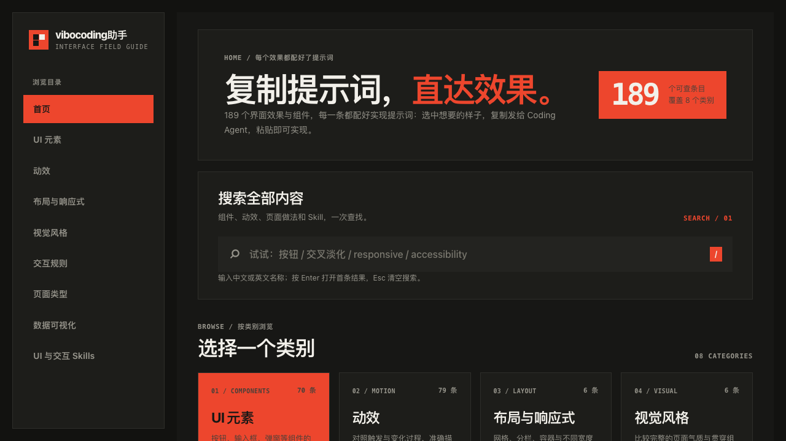
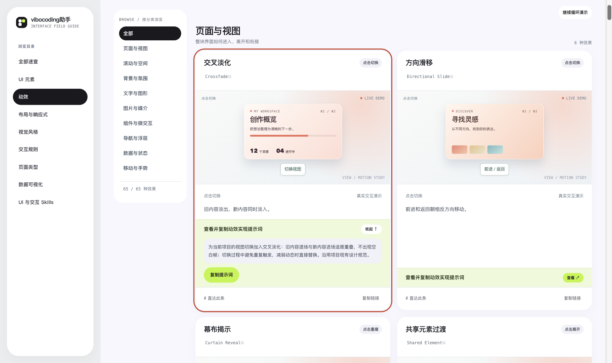
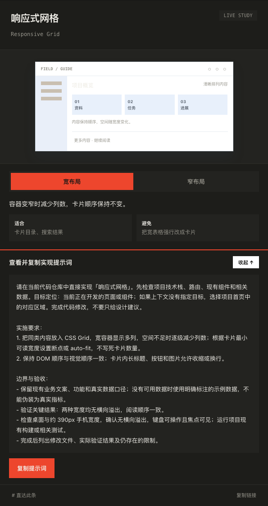
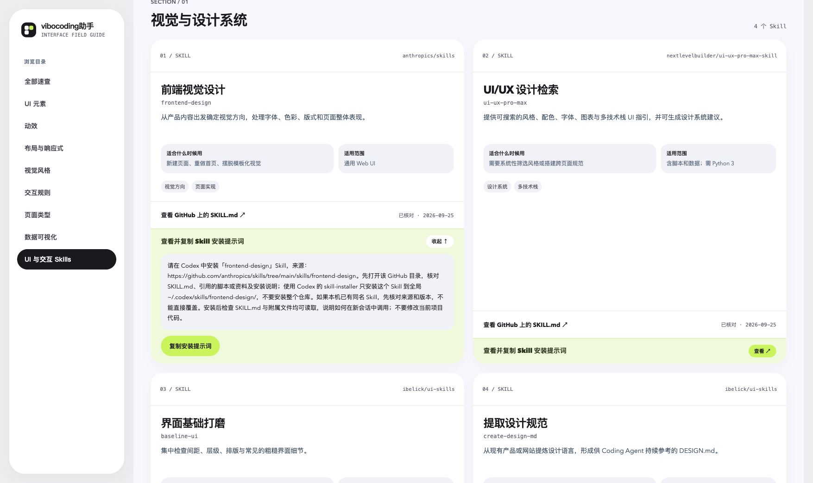
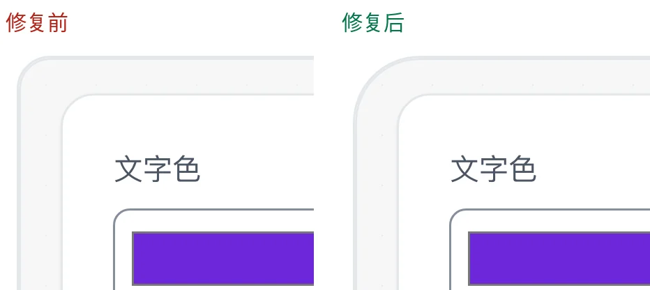
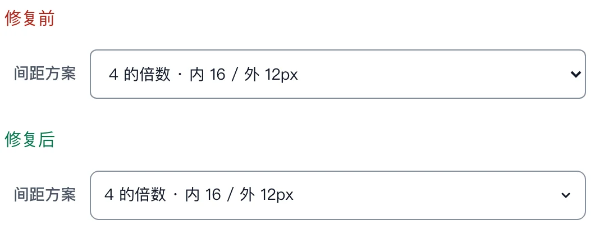
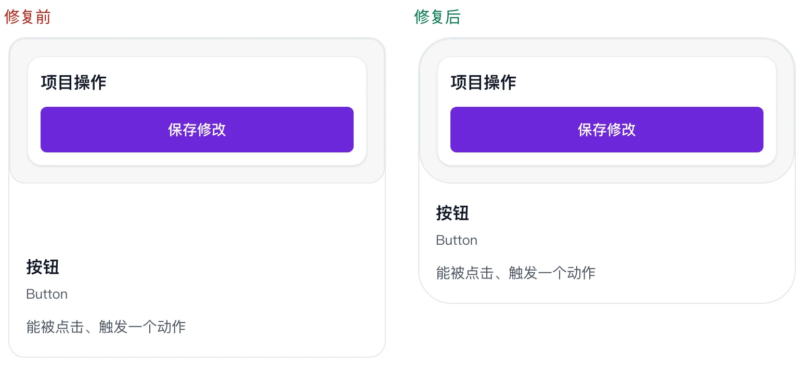
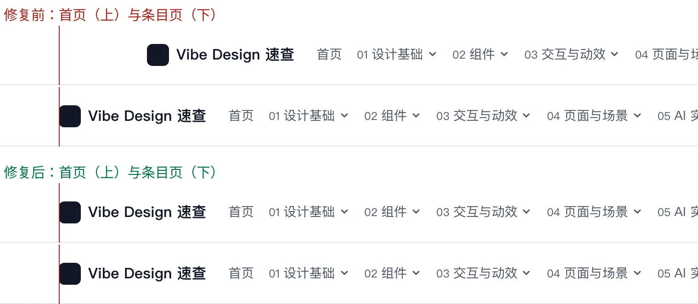
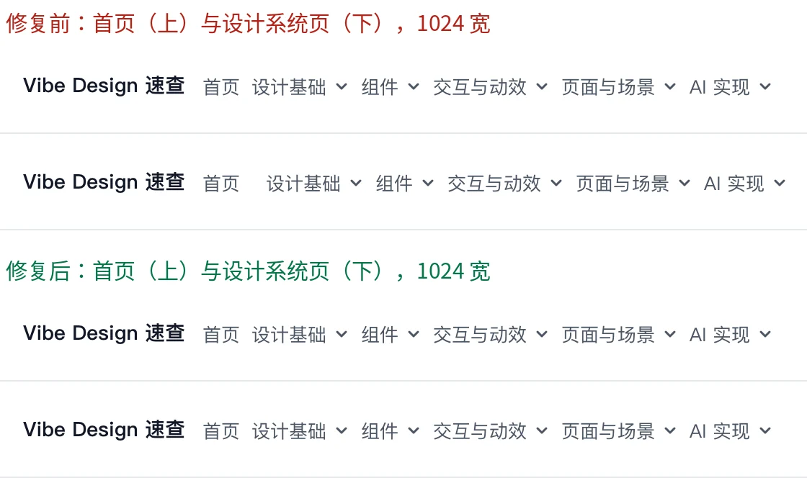

# Vibe Design 速查

## 项目简介

Vibe Design 速查是面向 Vibe Coding 初学者和设计师的界面速查网站，适合先确认界面效果，再把实现提示词交给 coding agent 的工作方式。

目前收录 192 个条目，按统一条目源统计如下。AI 实现栏目收录 10 个 UI 与交互 Skills，已计入总数。

| 分类 | 条目数 |
|---|---|
| 设计基础 | 17 |
| 组件 | 75 |
| 交互与动效 | 84 |
| 页面与场景 | 6 |
| AI 实现（Skills） | 10 |
| 合计 | 192 |

界面条目提供可操作的演示和可复制的实现提示词。演示运行在样式隔离的舞台中，便于观察组件状态、触发方式和动效变化，Skills 条目提供来源与安装提示词。项目同时维护设计系统、分层 UI 审计方法和自动化无头测试，用统一规则检查网站外框与演示细节。动效「实现规范」分区作为补充资料，单独维护。

**在线访问** [打开 Vibe Design 速查](https://zhang-netizen-1.github.io/vibocoding-assistant/)

**核心用法** 找到想要的界面效果，查看示例。每个条目的实现提示词默认展开，点「复制提示词」，直接粘贴给正在处理你项目的 coding agent。提示词描述了实现目标、交互与验收要点，需要时再补充业务内容。Skills 类提供可复制的 **Codex 安装提示词**。

## 网站截图

**首页** 按类别浏览，或直接搜索，每个条目都配可复制的实现提示词，复制给 Coding Agent 即可实现对应效果。



**动效条目** 先操作真实演示，确认效果，提示词默认展开，一键复制。例如「交叉淡化」条目会说明切换时旧内容与新内容如何衔接。



**布局等速查条目** 提示词包含适用目标、实施要求和检查方式，可直接交给 coding agent 在当前项目中实现。



**UI 与交互 Skills** 查看 GitHub 来源，并复制对应的 Codex 安装提示词。



## 如何使用

1. 在首页搜索或进入分类，找到需要的 UI 元素、动效或设计方案。
2. 阅读说明并操作示例，确认它符合预期。
3. 每个条目的提示词默认展开，直接点「复制提示词」，将内容粘贴到 coding agent 对话中。条目还提供直达链接，方便分享给协作者。
4. 若要安装 UI 与交互 Skill，进入 Skills 分类，核对来源后复制「安装提示词」发给 Codex。

可以参考 UI 元素中「按钮」条目的实现提示词。

> 实现可复用的按钮（Button）组件：支持主要、次要、危险三种用途样式，以及悬停、聚焦、禁用、加载状态，按钮文字与点击行为可配置，禁用或加载中不可重复触发。沿用项目现有设计规范。

## 设计系统与 UI 审计

设计系统记录网站外框与演示的颜色、字体、间距、圆角和动效 tokens，以及按钮、导航、卡片、Select 下拉等组件状态。嵌套圆角按实际间隙推导，画廊缩略图采用「外圆角 = 内圆角 + 间隙」的严格同心规则。具体数值与用法见[设计系统](docs/design-system.md)，另附[原网页离线副本](docs/design-system-page/index.html)。

UI 审计覆盖网站外框和演示 Shadow DOM，按对齐、字体、颜色、间距、圆角、状态、响应式与减弱动态逐层检查。在 1440／1024／768／390 宽度下先运行自动测量，再逐元素放大查看截图，记录页面、状态和修复结果。流程与判定标准见[UI 走查清单](docs/ui-audit-checklist.md)。

先按下节构建 `dist/`。无头检查需要 Node.js、Playwright 及其 Chromium 浏览器，`NODE_PATH` 应指向已安装 `playwright` 的 `node_modules`，例如 `export NODE_PATH="/实际路径/node_modules"`。表中各项可单独运行，只有焦点环检查需要先启动本地预览服务并传入 URL。

| 检查 | 覆盖内容 | 运行命令 |
|---|---|---|
| 分层 UI 审计 | 图标墨迹居中、字体与颜色、同行等高、实色按钮边框、四边内缩、瀑布流间距、同心圆角、品牌与导航横坐标、Select 箭头，另输出状态截图 | `node tests/ui_audit_headless.cjs --widths=1440,1024,768,390` |
| 几何检查 | 嵌套圆角、按钮间距、分段控件、文字裁切与指示条偏移 | `node tests/geometry_headless.cjs` |
| 焦点环 | 键盘 Tab 聚焦后，用截图像素检查焦点环四边是否缺失 | `node tests/focus_ring_headless.cjs http://localhost:4173/ --widths=1440,1024,768,390` |
| 提示胶囊定位 | 192 个条目在 1440／390 宽度下，提示胶囊距舞台左边与底边均为 13px | `node tests/hint_position_headless.cjs` |
| R1 回归 | 三类页面、四个宽度，覆盖悬停／触屏／减弱动态组合，检查品牌对齐、导航、缩略图圆角与内缩、播放控件及底部预留空间 | `node tests/r1_headless.cjs` |
| Python 单元测试 | 条目与分类、内容校验、搜索、旧锚点、构建产物及样式规则回归，部分检查会调用 Node.js | `python3 -m unittest discover -s tests -p 'test_*.py'` |

`ui_audit_headless.cjs` 和 `geometry_headless.cjs` 可追加条目路径片段筛选页面。除焦点环检查外，表中无头脚本直接从 `dist/` 提供资源，无需另启预览服务。R1 回归覆盖首页、栏目页和条目页；原设计系统页面已迁入文档，不再列入公共页面检查。

## 本地预览

需要 Python 3。网站本身为静态页面。

```bash
python3 scripts/build_site.py
python3 -m http.server 4173 --directory dist
```

在浏览器访问 http://localhost:4173/ 。`dist/` 是生成目录，页面与资源使用相对链接，发布时以 `dist/` 为网站根目录。`main` 分支更新后，GitHub Actions 会运行构建检查并将 `dist/` 部署到 GitHub Pages。

## 本轮界面打磨（新增）

以下均为修复前后对照，图中上方或左侧为修复前，红／绿标签已标在图片内。

**画廊缩略图同心圆角**

内容圆角 14px + 内边距 17px = 舞台圆角 31px，再加 1px 边框得到卡片圆角 32px，遵循「外圆角 = 内圆角 + 间隙」，四边内边距一致。截图宽度 1440px，局部放大 3 倍。



**下拉框箭头**

Select 使用导航同款 12px 箭头，箭头右内缩与文字左内边距均为 12px，并保持垂直居中，控件高 44px、圆角 8px，统一悬停、聚焦和禁用状态。截图宽度 1440px。



**去掉卡片底部留白**

桌面端可悬停且未开启减弱动态时，去掉缩略图下方为播放按钮预留的 52px 空白，触屏和减弱动态模式继续保留。截图宽度 1440px，取自组件画廊首张卡片。



**顶栏宽度统一**

首页与条目页顶栏统一为 1376px，使 logo 横坐标一致，图中红线为对齐参考。截图宽度 1440px。



**导航间距修复**

原设计系统页在 1024px 宽度下，「首页」与「设计基础」间距因触控目标规则误作用于导航而多出 10px，修复后与其他页面一致。该缺陷仅在此宽度出现，因此使用 1024px 截图，该页面现已迁入 docs，对应规范见[设计系统文档](docs/design-system.md)。



## 内容维护

- UI 元素源内容在 `网页UI元素速查.html`，动效源内容在 `动效速查-src/motion_entries.json`，演示与实现规范由同目录的模板、样式和脚本维护。
- 视觉风格、布局、交互规则、图表与场景的源内容在 `site-src/guide_pages.py`，基础令牌在 `site-src/token_entries.py`，统一分类在 `site-src/taxonomy.json`，编辑说明与提示词在 `site-src/content/`。
- UI 与交互 Skills 的来源和安装提示词在 `site-src/skill_catalog.py`。
- 首页、共用导航、条目页及搜索索引由 `site-src/redesign/templates.py` 生成，外框 tokens、样式和交互集中在 `site-src/redesign/`，演示皮肤在其 `demo-skins/` 子目录。修改视觉规则前先对照[设计系统](docs/design-system.md)，走查按[UI 审计清单](docs/ui-audit-checklist.md)执行。
- [测评报告](docs/evaluation-report.md)集中保留真实分数、用时、逐项证据与补充要求的效果；原始数据、对比图、提示词和演示原样维护在 `docs/evaluation/`，不进入公共站点构建。设计规范维护在[设计系统文档](docs/design-system.md)。
- 构建入口为 `scripts/build_site.py`，使用明确的文件清单生成 `dist/`，生成目录随构建重建。

## 构建检查

```bash
python3 -m unittest discover -s tests -p 'test_site_build.py'
```

条目保留稳定的访问路径和历史 HTML 锚点，例如 `components/button/`、`interactions/view-crossfade/` 和 `basics/grid/`。站点提供直达与复制链接操作，便于分享给协作者。
