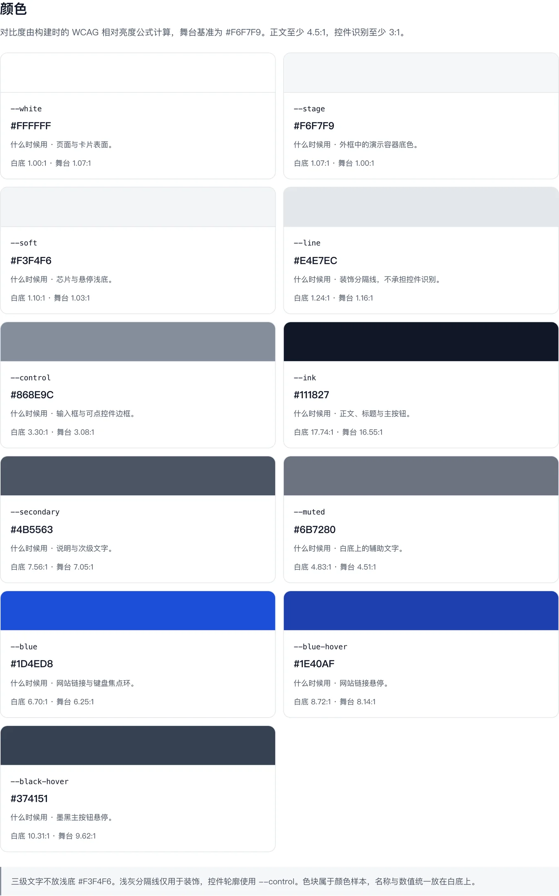
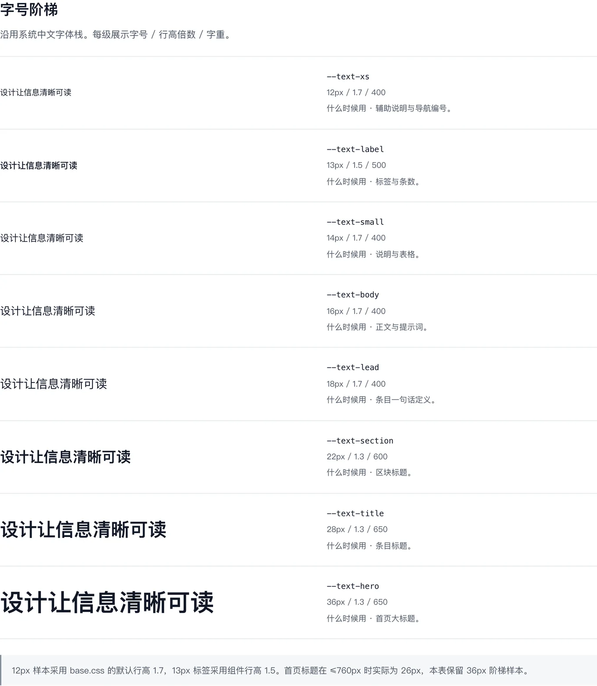
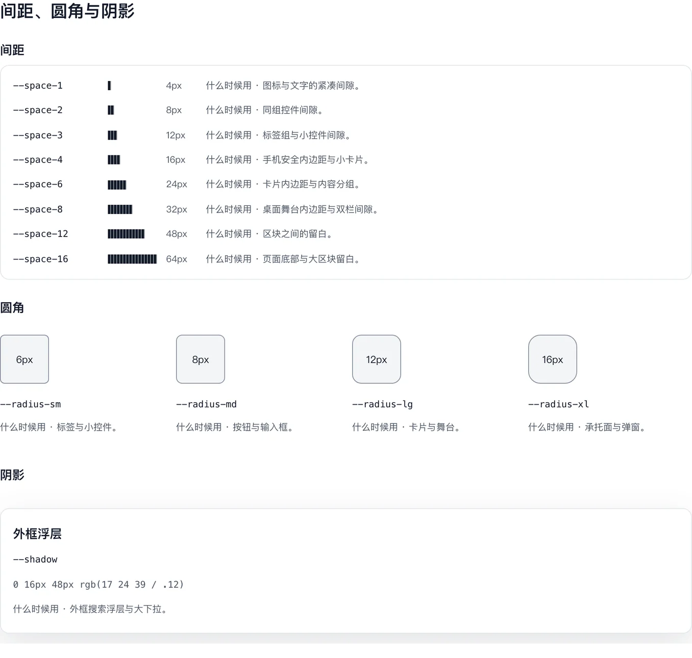
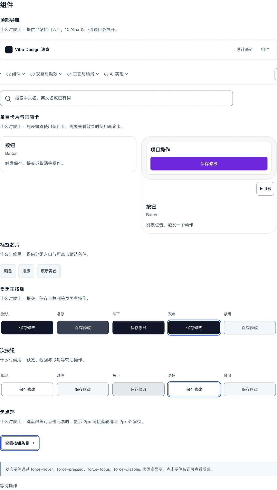
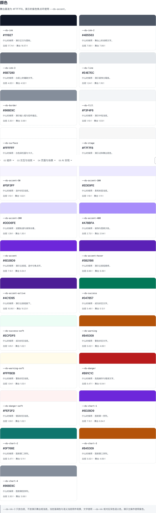
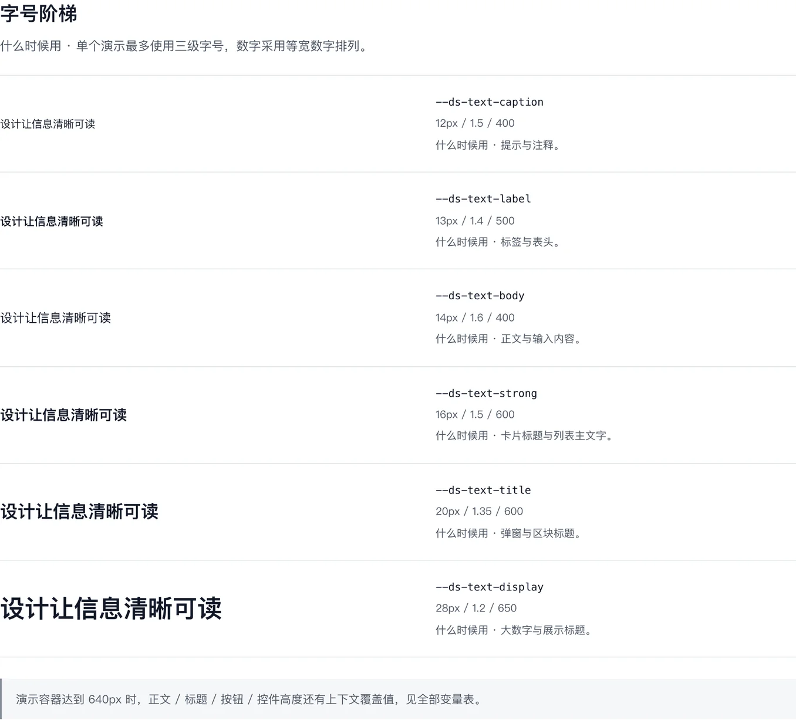
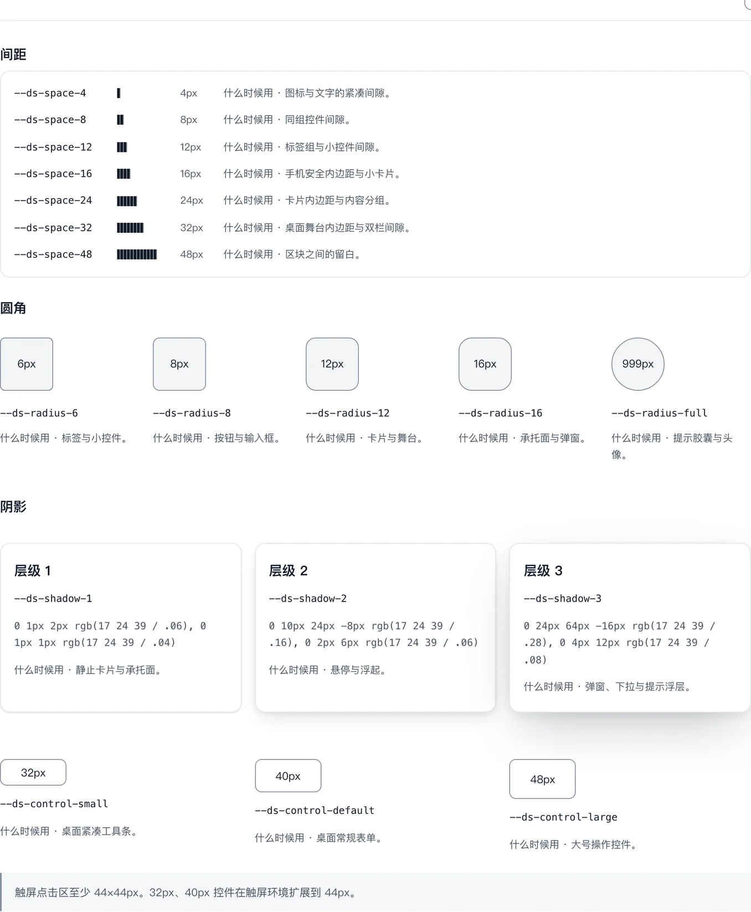
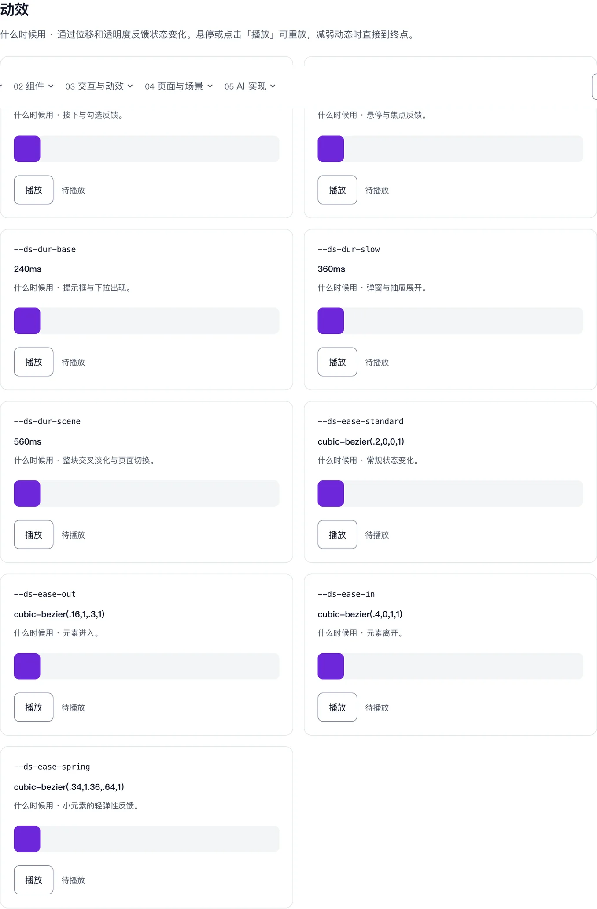
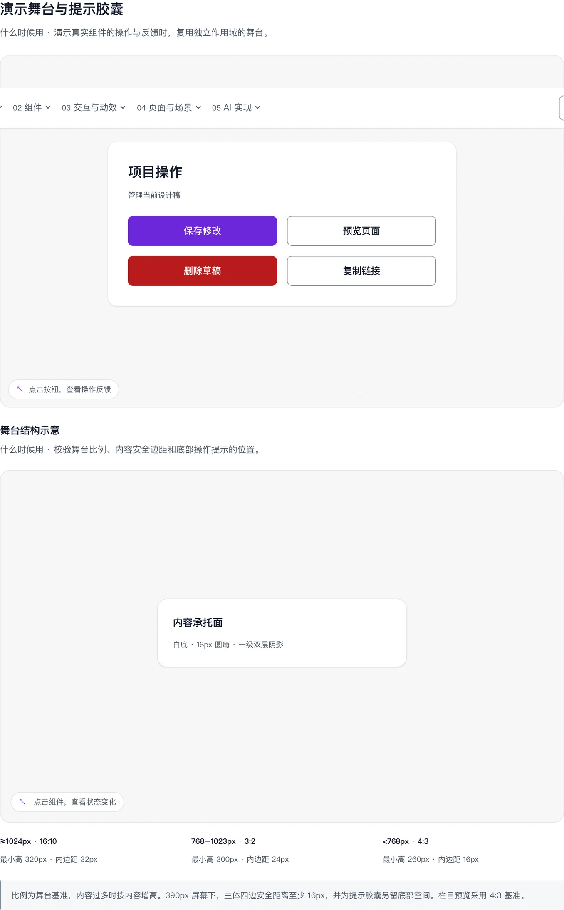
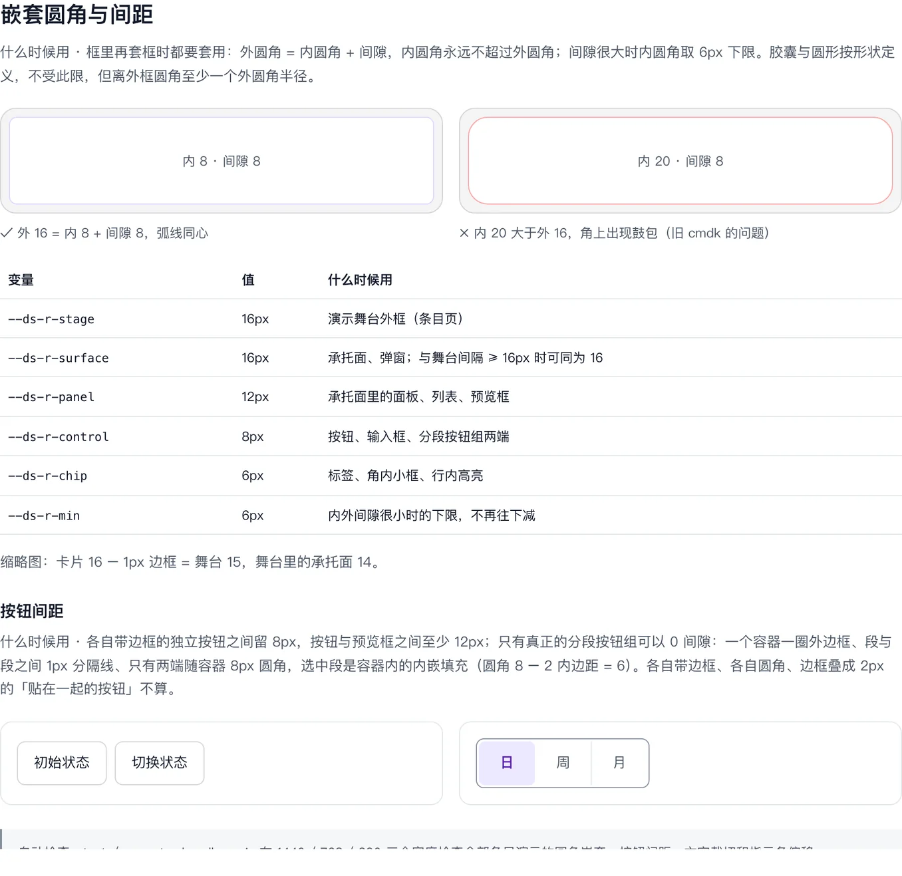

# 设计系统

本站使用浅色文档型设计系统。本文件集中维护网站外框与演示两套变量、组件状态和动效规范；原网页示例已改为静态截图，不再作为公共站点页面构建。

旧版深色 v3 规范已作废。当前规范统一在本文件维护。

## 来源与优先级

1. `site-src/redesign/tokens.css`、`base.css`、`site.css` 定义网站外框的实际表现。
2. `site-src/redesign/demo-spec.css` 定义演示 `--ds-*` 变量、舞台和响应式规则，组件局部覆盖以当前对应演示样式为准。
3. `docs/prd-design-knowledge-site.md` 第 15 节提供外框设计意图，`docs/demo-spec.md` 提供演示规格。
4. 文档数值与实现存在差异时，以实际 CSS 为准，并更新本文件末尾的差异记录。修改变量后同步核对色值、对比度、变量表及截图。

原网页的颜色、字号、尺寸、组件、动效与舞台示例已归档为本文件各节截图，截图取自 1440px 宽、1.5 倍像素密度的 WebP。原页面的页内目录、状态固定类与播放交互仅用于展示规范，不作为站点功能保留。

## 网站外框

### 颜色

舞台基准为 `#F6F7F9`。全部对比度均按当前 CSS 色值计算并保留两位小数。

| Token | 实际值 | 什么时候用 | 对白底 | 对外框舞台 |
|---|---|---|---|---|
| `--white` | `#FFFFFF` | 页面与卡片表面 | 1.00:1 | 1.07:1 |
| `--stage` | `#F6F7F9` | 外框中的演示容器底色 | 1.07:1 | 1.00:1 |
| `--soft` | `#F3F4F6` | 芯片与悬停浅底 | 1.10:1 | 1.03:1 |
| `--line` | `#E4E7EC` | 装饰分隔线，不承担控件识别 | 1.24:1 | 1.16:1 |
| `--control` | `#868E9C` | 输入框与可点控件边框 | 3.30:1 | 3.08:1 |
| `--ink` | `#111827` | 正文、标题与主按钮 | 17.74:1 | 16.55:1 |
| `--secondary` | `#4B5563` | 说明与次级文字 | 7.56:1 | 7.05:1 |
| `--muted` | `#6B7280` | 白底上的辅助文字 | 4.83:1 | 4.51:1 |
| `--blue` | `#1D4ED8` | 网站链接与键盘焦点环 | 6.70:1 | 6.25:1 |
| `--blue-hover` | `#1E40AF` | 网站链接悬停 | 8.72:1 | 8.14:1 |
| `--black-hover` | `#374151` | 墨黑主按钮悬停 | 10.31:1 | 9.62:1 |

- 正文对比度至少 4.5:1，控件识别边界至少 3:1。
- 三级文字 `--muted` 禁止放在浅底 `--soft` 上，其对比度为 4.39:1。
- `--line` 承担装饰分隔，输入框与可点控件轮廓使用 `--control`。
- 主操作使用墨黑底白字，链接与全站焦点环使用链接蓝。
- 原示例页将色块与标签分开排版，所有色值、用途、对比度文字放在白色表面上。

网站外框颜色、用途与对比度（原网页静态截图）。

### 字号

字体栈取 `--font`，使用本地系统中文字体。代码展示使用系统等宽字体。字号下限为 12px。

| Token | 字号 | 行高倍数 | 字重 | 什么时候用 |
|---|---|---|---|---|
| `--text-xs` | 12px | 1.7 | 400 | 辅助说明与导航编号 |
| `--text-label` | 13px | 1.5 | 500 | 标签与条数 |
| `--text-small` | 14px | 1.7 | 400 | 说明与表格 |
| `--text-body` | 16px | 1.7 | 400 | 正文与提示词 |
| `--text-lead` | 18px | 1.7 | 400 | 条目一句话定义 |
| `--text-section` | 22px | 1.3 | 600 | 区块标题 |
| `--text-title` | 28px | 1.3 | 650 | 条目标题 |
| `--text-hero` | 36px | 1.3 | 650 | 首页大标题 |

外框首页大标题在 ≤760px 时使用 26px，截图中的字号样本始终保留 36px，允许样本文字自然换行。实际 `base.css` 的通用 body 行高为 1.7，12px 样本采用该行高，13px 标签按实际组件规则展示 1.5。标题使用对应 h1/h2 规则。

| Token | 实际值 |
| --- | --- |
| `--font` | `"PingFang SC", "HarmonyOS Sans SC", "MiSans", "Microsoft YaHei", "Noto Sans SC", "Noto Sans CJK SC", system-ui, -apple-system, sans-serif` |

网站外框字号阶梯、行高与字重（原网页静态截图）。

### 间距、圆角与阴影

| Token | 实际值 | 什么时候用 |
|---|---|---|
| `--space-1` | `4px` | 图标与文字的紧凑间隙 |
| `--space-2` | `8px` | 同组控件间隙 |
| `--space-3` | `12px` | 标签组与小控件间隙 |
| `--space-4` | `16px` | 手机安全内边距与小卡片 |
| `--space-6` | `24px` | 卡片内边距与内容分组 |
| `--space-8` | `32px` | 桌面舞台内边距与双栏间隙 |
| `--space-12` | `48px` | 区块之间的留白 |
| `--space-16` | `64px` | 页面底部与大区块留白 |
| `--radius-sm` | `6px` | 标签与小控件 |
| `--radius-md` | `8px` | 按钮与输入框 |
| `--radius-lg` | `12px` | 卡片与舞台 |
| `--radius-xl` | `16px` | 承托面与弹窗 |
| `--shadow` | `0 16px 48px rgb(17 24 39 / .12)` | 外框搜索浮层与大下拉 |

- 4 / 8 / 12px 用于同组图标、标签和控件之间。
- 16 / 24px 用于卡片与手机内容内边距，32px 用于桌面舞台和双栏间隙。
- 48 / 64px 用于区块与页面留白。
- 6px 圆角用于标签，8px 用于按钮和输入框，12px 用于卡片与舞台，16px 用于外框与浮层。
- 外框阴影用于搜索浮层和大下拉。常规内容卡片依靠细边框组织层级。

网站外框间距、圆角与阴影（原网页静态截图）。

### 组件

| 组件 | 什么时候用 | 实现规则 |
|---|---|---|
| 顶部导航 | 跨栏目浏览 | 沿用 `nav-inner`、`brand`、`nav-link` 等真实类名，1024px 以下使用目录入口 |
| 搜索框 | 根据中文名、英文名或口语搜条目 | 复用 `home-search` 与 `data-search`，打开全站搜索浮层 |
| 条目卡片 | 展示名称与一句话说明 | 复用 `simple-card`，整个卡片链接可点 |
| 画廊卡 | 在进入条目前查看效果 | 复用 `gallery-card` 与原有演示作用域，触屏保留播放按钮 |
| 标签芯片 | 分组导航与筛选 | 复用 `chip`，浅底配次级文字 |
| 墨黑主按钮 | 提交、保存、复制 | 复用 `btn-primary`，悬停采用 `--black-hover` |
| 次按钮 | 预览、取消、返回 | 白底、控件灰边，悬停用浅底 |
| 焦点环 | 键盘聚焦任何可点击元素 | 2px `--blue`，外偏移 2px |

原示例页分别固定显示默认、悬停、按下、聚焦、禁用五种状态；对应固定类为 `force-hover`、`force-pressed`、`force-focus`、`force-disabled`。按下使用轻微缩放，禁用使用原生 disabled 语义与可辨识的灰阶。触屏点击区域至少 44×44px。

| 状态 | 墨黑主按钮 | 次按钮 |
|---|---|---|
| 默认 | `btn-primary`，`--ink` 墨黑底白字 | 白底，`--control` 边框 |
| 悬停 | `--black-hover` 背景与边框 | `--soft` 背景 |
| 按下 | `--ink` 背景，`inset 0 2px 4px rgb(255 255 255 / .2)` 内阴影 | `--line` 背景，`--secondary` 边框 |
| 聚焦 | 2px `--blue` 轮廓，外偏移 2px | 2px `--blue` 轮廓，外偏移 2px |
| 禁用 | 原生 `disabled`；`--soft` 底、`--secondary` 文字、`--control` 边框、`not-allowed` 光标 | 同主按钮 |

原示例按钮文字为「保存修改」，点击后状态区显示「已触发『按钮文字』」，未操作时显示「等待操作」；原画廊样例取按钮条目，普通画廊播放按钮预留 60px 底部空间，可悬停且未减弱动态时去除，窄屏／触屏／减弱动态时保留。以上为截图来源的展示行为。

| Token | 实际值 |
| --- | --- |
| `--nav-height` | `64px` |
| `--entry-shell` | `1376px` |
| `--header-width` | `var(--entry-shell)` |

网站外框导航、搜索、卡片、按钮五种状态与焦点环（原网页静态截图）。

## 演示

### 颜色

舞台基准为 `#F7F7F8`。强调色使用紫色，成功、警告、危险使用相应语义色，图表按紫、青、琥珀、灰排序。

| Token | 实际值 | 什么时候用 | 对白底 | 对演示舞台 |
|---|---|---|---|---|
| `--ds-ink` | `#111827` | 演示正文与图标 | 17.74:1 | 16.57:1 |
| `--ds-ink-2` | `#4B5563` | 舞台上的说明文字 | 7.56:1 | 7.06:1 |
| `--ds-ink-3` | `#6B7280` | 白底上的辅助文字 | 4.83:1 | 4.52:1 |
| `--ds-line` | `#E4E7EC` | 演示装饰分隔线 | 1.24:1 | 1.16:1 |
| `--ds-border` | `#868E9C` | 演示输入框与控件描边 | 3.30:1 | 3.08:1 |
| `--ds-fill` | `#F3F4F6` | 演示中性浅底 | 1.10:1 | 1.03:1 |
| `--ds-surface` | `#FFFFFF` | 白色承托面与卡片 | 1.00:1 | 1.07:1 |
| `--ds-stage` | `#F7F7F8` | 演示点阵舞台底色 | 1.07:1 | 1.00:1 |
| `--ds-accent-50` | `#F5F3FF` | 选中状态浅底 | 1.10:1 | 1.02:1 |
| `--ds-accent-100` | `#EDE9FE` | 柔和标签浅底 | 1.19:1 | 1.11:1 |
| `--ds-accent-200` | `#DDD6FE` | 进度轨道与装饰光晕 | 1.39:1 | 1.30:1 |
| `--ds-accent-400` | `#A78BFA` | 装饰与图表次色 | 2.72:1 | 2.54:1 |
| `--ds-accent` | `#6D28D9` | 演示主按钮、选中与焦点环 | 7.10:1 | 6.64:1 |
| `--ds-accent-hover` | `#5B21B6` | 演示主按钮悬停 | 8.98:1 | 8.39:1 |
| `--ds-accent-active` | `#4C1D95` | 演示主按钮按下 | 10.95:1 | 10.23:1 |
| `--ds-success` | `#047857` | 成功状态文字 | 5.48:1 | 5.12:1 |
| `--ds-success-soft` | `#ECFDF5` | 成功状态浅底 | 1.05:1 | 1.02:1 |
| `--ds-warning` | `#B45309` | 警告状态文字 | 5.02:1 | 4.69:1 |
| `--ds-warning-soft` | `#FFFBEB` | 警告状态浅底 | 1.04:1 | 1.03:1 |
| `--ds-danger` | `#B91C1C` | 危险操作与错误文字 | 6.47:1 | 6.04:1 |
| `--ds-danger-soft` | `#FEF2F2` | 错误状态浅底 | 1.09:1 | 1.02:1 |
| `--ds-chart-1` | `#6D28D9` | 图表第一序列 | 7.10:1 | 6.64:1 |
| `--ds-chart-2` | `#0F766E` | 图表第二序列 | 5.47:1 | 5.11:1 |
| `--ds-chart-3` | `#B45309` | 图表第三序列 | 5.02:1 | 4.69:1 |
| `--ds-chart-4` | `#868E9C` | 图表第四序列 | 3.30:1 | 3.08:1 |

- `--ds-ink-3` 只放白底，禁止放在演示舞台或浅灰背景上。
- 强调浅色与语义浅底用于背景，文字使用主文字色或对应深色语义色。
- 演示主按钮及焦点环使用 `--ds-accent`，悬停与按下分别使用专门的深色 token。
- `--ds-line` 为装饰线，识别控件使用 `--ds-border`。

演示颜色、语义用途与对比度（原网页静态截图）。

### 字号

演示字体栈取 `--ds-font`，数字使用 `tabular-nums`。每个演示最多使用三级字号。

| Token | 字号 | 行高倍数 | 字重 | 什么时候用 |
|---|---|---|---|---|
| `--ds-text-caption` | 12px | 1.5 | 400 | 提示与注释 |
| `--ds-text-label` | 13px | 1.4 | 500 | 标签与表头 |
| `--ds-text-body` | 14px | 1.6 | 400 | 正文与输入内容 |
| `--ds-text-strong` | 16px | 1.5 | 600 | 卡片标题与列表主文字 |
| `--ds-text-title` | 20px | 1.35 | 600 | 弹窗与区块标题 |
| `--ds-text-display` | 28px | 1.2 | 650 | 大数字与展示标题 |

`--ds-text-display-letter-spacing` 的实际值为 `-.01em`。基础样本展示标准阶梯，主体还存在基于演示容器宽度的字号覆盖，详见差异表与下表的变量与上下文覆盖值。

| Token | 实际值 |
| --- | --- |
| `--ds-font` | `"PingFang SC","HarmonyOS Sans SC","MiSans","Microsoft YaHei","Noto Sans SC","Noto Sans CJK SC",system-ui,-apple-system,sans-serif` |
| `--ds-text-display-letter-spacing` | `-.01em` |
| `--ds-text-caption-line-height` | `1.5` |
| `--ds-text-caption-weight` | `400` |
| `--ds-text-label-line-height` | `1.4` |
| `--ds-text-label-weight` | `500` |
| `--ds-text-body-line-height` | `1.6` |
| `--ds-text-body-weight` | `400` |
| `--ds-text-strong-line-height` | `1.5` |
| `--ds-text-strong-weight` | `600` |
| `--ds-text-title-line-height` | `1.35` |
| `--ds-text-title-weight` | `600` |
| `--ds-text-display-line-height` | `1.2` |
| `--ds-text-display-weight` | `650` |
| `--ds-demo-body` | `14px` |
| `--ds-demo-heading` | `16px` |
| `--ds-demo-title` | `20px` |
| `--ds-demo-button` | `14px` |

响应式与舞台局部覆盖（按 CSS 中出现顺序列出；容器 ≥640px 的主体字号增大，≥880px 交互舞台进一步调整主体宽度）：

| Token | 上下文覆盖值 |
| --- | --- |
| `--ds-demo-body` | `16px` |
| `--ds-demo-heading` | `22px` |
| `--ds-demo-title` | `24px` |
| `--ds-demo-button` | `15px` |
| `--ds-demo-control` | `48px` |

演示字号阶梯、行高与字重（原网页静态截图）。

### 间距、圆角、阴影与控件

| Token | 实际值 | 什么时候用 |
|---|---|---|
| `--ds-radius-6` | `6px` | 标签与小控件 |
| `--ds-radius-8` | `8px` | 按钮与输入框 |
| `--ds-radius-12` | `12px` | 卡片与舞台 |
| `--ds-radius-16` | `16px` | 承托面与弹窗 |
| `--ds-radius-full` | `999px` | 提示胶囊与头像 |
| `--ds-space-4` | `4px` | 图标与文字的紧凑间隙 |
| `--ds-space-8` | `8px` | 同组控件间隙 |
| `--ds-space-12` | `12px` | 标签组与小控件间隙 |
| `--ds-space-16` | `16px` | 手机安全内边距与小卡片 |
| `--ds-space-24` | `24px` | 卡片内边距与内容分组 |
| `--ds-space-32` | `32px` | 桌面舞台内边距与双栏间隙 |
| `--ds-space-48` | `48px` | 区块之间的留白 |
| `--ds-control-small` | `32px` | 桌面紧凑工具条 |
| `--ds-control-default` | `40px` | 桌面常规表单 |
| `--ds-control-large` | `48px` | 大号操作控件 |
| `--ds-shadow-1` | `0 1px 2px rgb(17 24 39 / .06), 0 1px 1px rgb(17 24 39 / .04)` | 静止卡片与承托面 |
| `--ds-shadow-2` | `0 10px 24px -8px rgb(17 24 39 / .16), 0 2px 6px rgb(17 24 39 / .06)` | 悬停与浮起 |
| `--ds-shadow-3` | `0 24px 64px -16px rgb(17 24 39 / .28), 0 4px 12px rgb(17 24 39 / .08)` | 弹窗、下拉与提示浮层 |

- 间距按 4px 基准，4 / 8 / 12px 用于同组元素，16 / 24 / 32px 用于主体内边距，48px 用于区块间距。
- 6 / 8 / 12 / 16 / 999px 圆角分别用于小标签、按钮输入框、卡片、承托面浮层、胶囊头像。
- 三级阴影均有两层，一级用于静止承托面，二级用于悬停浮起，三级用于弹窗、下拉与提示浮层。
- 桌面控件高度为 32 / 40 / 48px，触屏点击区域至少 44×44px。原示例页的 32px 与 40px 控件在触屏环境扩展至 44px。

| Token | 实际值 |
| --- | --- |
| `--ds-demo-control` | `44px` |

演示间距、圆角、双层阴影与三档控件高度（原网页静态截图）。

### Select 下拉

所有原生下拉使用 `.ds-select-wrap > select`，共享规则位于每个演示 ShadowRoot 最后加载的 `demo-accessibility.css`，变量定义于 `demo-spec.css`。

| Token | 实际值 | 用途 |
|---|---|---|
| `--ds-select-pad-x` | `12px` | 文字左内边距与箭头盒右侧内缩 |
| `--ds-select-chevron` | `12px` | 箭头盒宽高 |
| `--ds-select-gap` | `8px` | 文字区与箭头盒之间的预留间距 |

- `appearance:none`，右内边距为三个变量之和 `32px`。包装层贴合 select 边框盒，箭头盒右侧内缩 `12px`，垂直中心偏差不超过 `0.5px`。
- `.ds-select-wrap::after` 使用与导航 caret 相同的 `12×12` SVG 路径 `M3 4.5 6 7.5 9 4.5` 作为 CSS mask，通过 `background-color:currentColor` 继承文字颜色，兼容深色主题。
- 高度至少 `44px`，城市选择器沿用容器对应的 `44/48px` 高度。圆角为 `--ds-r-control`（`8px`），边框为 `1px solid --ds-border`。
- 默认使用 `--ds-surface` 底色和 `--ds-ink` 文字，悬停使用 `--ds-fill`。`:focus-visible` 为 `2px solid --ds-accent` 外环，偏移 `2px`。
- 原生 `disabled` 状态保留，包装层整体透明度为 `.45`，箭头与控件同步变淡，鼠标样式为 `not-allowed`。

### 动效

| Token | 实际值 |
|---|---|
| `--ds-dur-instant` | `100ms` |
| `--ds-dur-fast` | `160ms` |
| `--ds-dur-base` | `240ms` |
| `--ds-dur-slow` | `360ms` |
| `--ds-dur-scene` | `560ms` |
| `--ds-ease-standard` | `cubic-bezier(.2,0,0,1)` |
| `--ds-ease-out` | `cubic-bezier(.16,1,.3,1)` |
| `--ds-ease-in` | `cubic-bezier(.4,0,1,1)` |
| `--ds-ease-spring` | `cubic-bezier(.34,1.36,.64,1)` |

- 100ms 用于按下与勾选，160ms 用于悬停与焦点，240ms 用于提示框与下拉，360ms 用于弹窗和抽屉，560ms 用于场景变化。
- standard 用于状态变化，out 用于进入，in 用于离开，spring 用于小元素轻弹性。
- 离开时长约为进入的 0.75 倍，条目自身研究特定动效参数时沿用该条目的数值。
- 原示例页每个时长与每条缓动都有独立的播放按钮。鼠标悬停样本或点击播放都可重放。每次播放执行一轮，连续触发会取消当前播放并重启。
- 样本通过 Web Animations API 仅改变 transform 与 opacity。`prefers-reduced-motion: reduce` 下直接显示终点，运行期间开启减弱动态也会取消播放并保留终点。
- 外框实际还包含抽屉 `.2s ease` 入场与菜单 180ms 延迟关闭。它们属于外框现有行为，原示例页的九个动效样本按 `--ds-*` 参数演示：时长样本采用 `--ds-ease-standard`，缓动样本采用 `--ds-dur-scene`（560ms）；单轮动画中 40×40px 方块从轨道左端移动到右端，透明度由 0.4 变为 1。

演示五档时长与四条缓动曲线的静态示例（原网页静态截图）。

### 舞台与提示胶囊

真实演示通过 `templates.demo_scope(...)` 嵌入 `components/button` 的当前演示。该函数实际定义于 `site-src/redesign/templates.py`，内部调用 `demos.markup(...)`。页面复用现有 demo runtime、UI 行为、ShadowRoot 样式和组件资源。

| 范围 | 设计比例基准 | 最小高度 | 主体内边距 |
|---|---|---|---|
| ≥1024px 主演示 | 16:10 | 320px | 32px |
| 768–1023px 主演示 | 3:2 | 300px | 24px |
| <768px 主演示 | 4:3 | 260px | 16px |
| 栏目预览 | 4:3 | 随内容 | 16px |

- 条目页舞台使用淡点阵、`--ds-r-stage`（16px）圆角和装饰分隔线，承托面使用白底、16px 圆角和一级双层阴影。
- 主体居中，内容增多时按内容增高。390px 屏幕下，主体四边安全距离至少 16px。
- 提示胶囊使用白底、次级文字、细边框、999px 圆角和 12px 字号。真实舞台胶囊定位取现有 CSS 的左下 12px，主体安全内边距按上述规则另行保证。
- 提示胶囊存在时，真实舞台预留至少 56px 底部空间。演示容器宽度 ≤380px 时增加至 76px。原示例页额外提供静态舞台结构示意；结构示意的胶囊位于左下 16px，水平／垂直 padding 为 12px／6px，间距 8px，主体最大宽 400px、padding 24px，示意舞台底部 padding 为 76px；真实舞台沿用左下 12px 定位。

| Token | 实际值 |
| --- | --- |
| `--ds-subject-width` | `clamp(320px,52%,640px)` |

响应式与舞台局部覆盖（按 CSS 中出现顺序列出；容器 ≥640px 的主体字号增大，≥880px 交互舞台进一步调整主体宽度）：

| Token | 上下文覆盖值 |
| --- | --- |
| `--ds-stage-inset` | `32px` / `24px` / `16px` |
| `--ds-thumb-inset` | `var(--thumb-inset,16px)` |
| `--ds-subject-width` | `clamp(420px,66%,560px)` / `clamp(560px,62%,680px)` |

按钮演示舞台、承托面与底部提示胶囊（原网页静态截图）。

## 嵌套圆角与间距（强制）

下图保存嵌套圆角与按钮间距示例；完整规则见 [演示规格](demo-spec.md) 同名一节。

- 正例：外 16 = 内 8 + 间隙 8，弧线同心。反例：内 20 大于外 16，角上鼓包（旧 cmdk 的问题）。
- 外圆角 = 内圆角 + 间隙；内圆角永远不超过外圆角；间隙很大时内圆角取下限 6px（`--ds-r-min`）。
- 层级变量：`--ds-r-stage` 16 ≥ `--ds-r-surface` 16 > `--ds-r-panel` 12 > `--ds-r-control` 8 > `--ds-r-chip` 6。

| Token | 实际值 | 什么时候用 |
|---|---|---|
| `--ds-r-stage` | `16px` | 条目页演示舞台外框 |
| `--ds-r-surface` | `16px` | 承托面、弹窗；与舞台间隔 ≥16px 时可同为 16px |
| `--ds-r-panel` | `12px` | 承托面里的面板、列表、预览框 |
| `--ds-r-control` | `8px` | 按钮、输入框、分段按钮组两端 |
| `--ds-r-chip` | `6px` | 标签、角内小框、行内高亮 |
| `--ds-r-min` | `6px` | 内圆角下限，不再继续减小 |

- 画廊缩略图采用严格同心公式，变量定义在 `site-src/redesign/tokens.css` 的 `:root`，通过宿主继承到 Shadow DOM：

| Token | 定义 | 当前值 |
|---|---|---|
| `--thumb-content-radius` | 内容卡圆角 | 14px |
| `--thumb-inset` | 舞台 padding；`--ds-thumb-inset` 读取此值 | 16px |
| `--thumb-stage-border` | 舞台边框 | 1px |
| `--thumb-stage-radius` | `calc(var(--thumb-content-radius) + var(--thumb-inset) + var(--thumb-stage-border))` | 31px |
| `--gallery-card-border` | 画廊卡边框 | 1px |
| `--gallery-card-radius` | `calc(var(--thumb-stage-radius) + var(--gallery-card-border))` | 32px |

| 视口宽度 | 内容卡圆角 | 舞台 padding / 边框 | 内容卡四边外缘内缩 | 舞台圆角 | 画廊边框 / 圆角 |
|---|---|---|---|---|---|
| 1440px | 14px | 16px / 1px | 17px | 31px | 1px / 32px |
| 1024px | 14px | 16px / 1px | 17px | 31px | 1px / 32px |
| 768px | 14px | 16px / 1px | 17px | 31px | 1px / 32px |
| 390px | 14px | 16px / 1px | 17px | 31px | 1px / 32px |

上述为 CSS 定义与公式结果。所有宽度共用同一组公式；如增加 inset 断点，须在该断点同步使用同一组派生变量。`.simple-card` 等其他外框卡片保持 16px，六种视觉风格的专属样式不变。

角落控件采用 `calc(var(--gallery-card-radius) - var(--gallery-card-border) - var(--gallery-control-offset))`，仅适用于定位在画廊卡片自身角落的 `.motion-grid .gallery-card :is(.play-button,.reduced-link)`：动效卡的 `.mini-stage` 为 `position:static`，播放按钮和链接相对卡片内边缘偏移 16px，圆角为 15px，外缘距离还包含 1px 卡片边框。普通画廊的控件定位于 `position:relative` 的 `.mini-stage` 内，不在卡片自身角落区域，保留 R1 前的圆角：`.play-button` 为 8px，`.reduced-link` 为 0。动效卡播放按钮高度至少 44px，普通播放按钮最小高度 32px（触屏/窄屏至少 44px）。

仅在 `(hover:hover) and (prefers-reduced-motion:no-preference)` 且两个控件均隐藏时移除缩略图底部预留空间。≤1023px 显示播放按钮的规则、触屏和减弱动态模式保留原预留空间；动效卡原本没有预留条。静态预览在上述悬停/动态条件下两个控件始终隐藏，底部空间为 0。

页头 `.nav-inner` 统一使用 `--header-width:var(--entry-shell)`，`--entry-shell:1376px`；保持现有 32px / 16px 水平 padding，正文宽度规则不变。
- 胶囊与圆形按形状定义，不受此限，但离外框圆角至少一个外圆角半径。
- 独立按钮之间 8px，按钮与预览框之间至少 12px；只有共用一圈外边框、段间有 1px 分隔线、两端随容器使用 8px 圆角的分段按钮组可以 0 间隙。选中段为内嵌填充，圆角 8 − 2px 内边距 = 6px。各自带边框和圆角、边框叠成 2px 的相邻按钮不属于分段按钮组。
- 自动检查：`tests/geometry_headless.cjs`（1440 / 768 / 390，全部条目演示；圆角嵌套、按钮间距、文字裁切、比内容窄、指示条偏移 > 2px）。

嵌套圆角与按钮间距静态示例；缩略图数值采用本节现行规则，旧示例差异见下表。

## 文档与实际实现的差异

| 来源 | 说明或原数值 | 当前实际实现与采用规则 |
|---|---|---|
| 旧 `docs/design-system.md` | 深色 v3、荧光绿、侧栏和大圆角 | 已作废，改用当前浅色文档型外框与紫色演示体系 |
| PRD §15.3 与 Demo Spec §1 | 舞台分别记为 #F6F7F9、#F7F7F8 | 外框 `--stage` 为 #F6F7F9，演示 `--ds-stage` 为 #F7F7F8，分作用域展示 |
| PRD §15.3 的对比度精度 | 示例值包括分隔线 1.24、控件边框 3.3、三级文字对外框舞台 4.51 | 这些值与当前计算一致，统一展示为 1.24、3.30、4.51，按当前 CSS 色值计算，变更时同步更新 |
| Demo Spec §2 的约数 | 次级文字对舞台 7.0、success 5.5、warning 5.0、danger 6.5 | 两位小数实际为 7.06、5.48、5.02、6.47，以公式输出为准 |
| PRD §15.4 最小字号行高 | 12px / 1.5 / 400 | `base.css` body 默认 1.7，具体组件存在 1.5 和 1.7，原示例页的 12px 样本采用实际默认 1.7 |
| Demo Spec §1 比例表 | 16:10、3:2、4:3 | 真实主演示使用 `aspect-ratio:auto` 与 cqi 最小高度来保持内容可见，分别以 62.5 / 66.667 / 75cqi 为基准，允许按内容增高 |
| Demo Spec §1 栏目舞台 | 4:3 与16px 内边距 | 当前非交互舞台以 `min-height:75cqi` 表达比例基准，最终高度还会受内容与卡片控件影响 |
| Demo Spec §3 字号阶梯 | 12 / 13 / 14 / 16 / 20 / 28 | 基础阶梯保留，容器 ≥640px 时实际主体变量覆盖为正文16、标题22/24、按钮15、控件48，本文件变量表同时展示覆盖值 |
| Demo Spec §1 主体宽度 | 主体居中 | 当前 `--ds-subject-width` 基础 clamp(320px,52%,640px)，≥640px 覆盖 clamp(420px,66%,560px)，≥880px 交互舞台覆盖 clamp(560px,62%,680px) |
| PRD §15.5 全站蓝色焦点环与 Demo Spec §2 | 外框蓝、演示紫 | 外框采用 2px 链接蓝与 2px 偏移，演示采用 2px 紫与 2px 偏移 |
| 请求中的函数位置 | `demos.py` 里的 `demo_scope(...)` | 真实 API 在 `templates.py`，原示例页直接复用该函数与 `demos.markup(...)` |
| 原示例页嵌套圆角说明 | 缩略图卡片 16 − 1px 边框 = 舞台 15，承托面 14 | 旧说明已由 R1 同心规则替代；当前内容卡 14、内缩 17、舞台 31、画廊卡 32，以本文件强制规则为准 |
| 原文舞台圆角描述 | 舞台使用 12px 圆角 | 当前条目舞台使用 `--ds-r-stage`（16px），画廊缩略图使用派生舞台圆角 31px；12px 为通用 `--ds-radius-12` |

对比度计算将每个 sRGB 通道归一化，≤0.04045 时除以 12.92，其余使用 `((c + 0.055) / 1.055) ** 2.4`。相对亮度权重为 0.2126、0.7152、0.0722。最终对比度为 `(较高亮度 + 0.05) / (较低亮度 + 0.05)`。

## 构建与验证交接

- 设计系统仅维护在本文档及 `images/design-system/` 截图中；公共构建不再生成原页面或其专用样式。
- 修改 tokens 或 `demo-spec.css` 后，同步更新对应 Markdown 表格、用途、对比度与截图，保留实际实现差异记录。
- `tests/test_redesign_tokens.py` 保留共享 tokens、字号阶梯、动效参数、CSS 值和文档完整性检查，并独立重算颜色对比度。
- `tests/test_site_build.py` 检查已移除页面、重定向、导航和搜索隔离；`tests/test_editorial_content.py` 检查测评资料及内容保真。
- `tests/ui_audit_headless.cjs`、`tests/geometry_headless.cjs`、`tests/r1_headless.cjs` 继续检查其余公共页面，保留导航横坐标与原有几何判据。
- 页面构建、依赖 dist 的测试、浏览器截图及视觉评审分别记录；静态截图不代替当前页面的交互验证。
