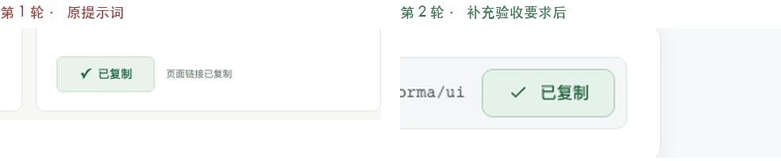
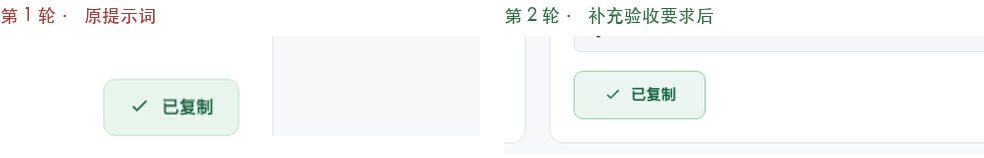
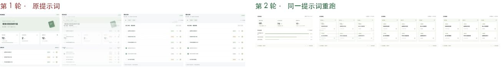
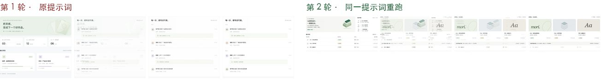
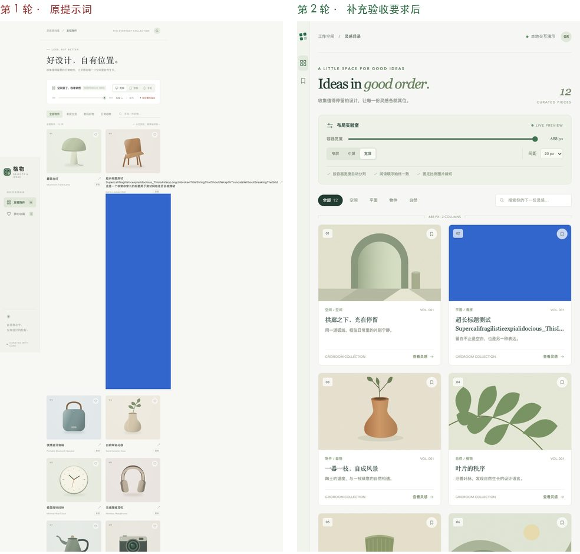
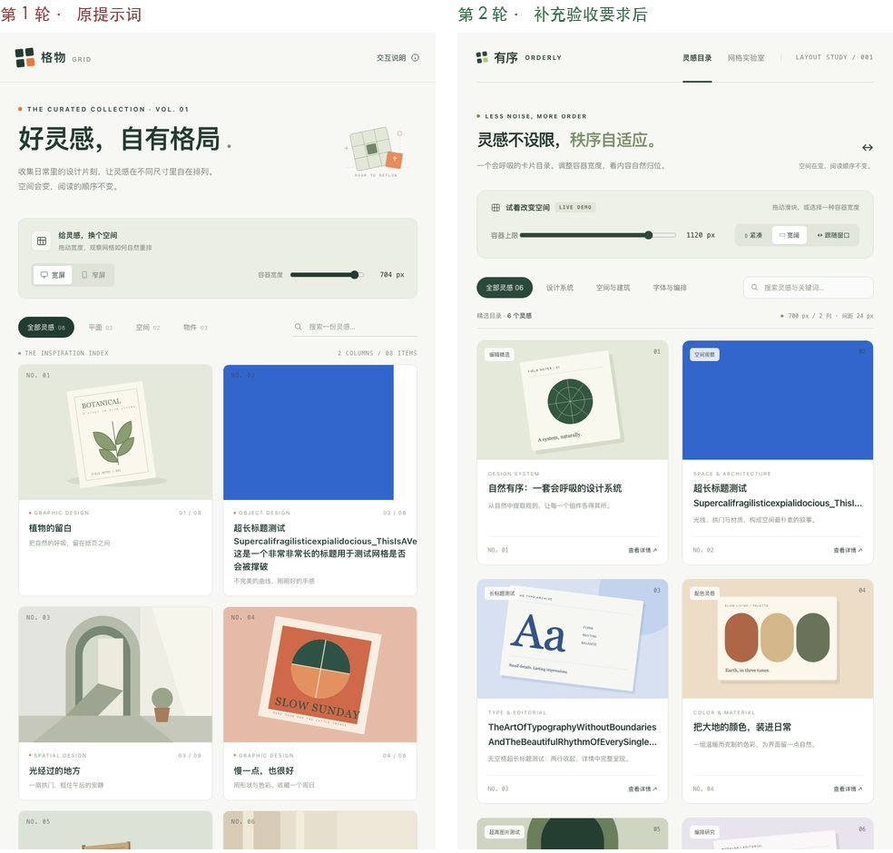

# 测评报告

## 概览

设计意图测评台 · 测评结果

同一条提示词，分别交给 Codex 和 Hermes 两个编程 AI 实现，再用同一张评分表打分。第 1 轮用速查站原提示词；第 2 轮只在提示词后补几句「补充验收要求」，看说清意图能不能把分数拉上来。

## 主结论

写进提示词的要求很稳，没写的每次可能变。

- 第 1 轮丢分的地方，几乎都是原提示词没提的：按下态、焦点环对比度、设计令牌、长内容、列数规则。
- 第 2 轮把这些用设计师的话补进去后，按钮和网格两家都从 12–14 分升到 16 分。
- 交叉淡化的提示词一个字没改，Codex 两轮都是 16 分，Hermes 却从 16 分掉到 13 分：没写死的时长、缓动、连点表现，每次重跑都可能换一种做法。

## 总分对比

第 1 轮 → 第 2 轮；每条满分 16。交叉淡化为同一提示词重跑。

| 条目 | Codex | Hermes |
| --- | --- | --- |
| [按钮](#button) | 13 → 16 /16 | 12 → 16 /16 |
| [交叉淡化](#crossfade) | 16 → 16 /16 | 16 → 13 /16 |
| [响应式网格](#grid) | 12 → 16 /16 | 14 → 16 /16 |

## 运行用时

实际墙钟时间（`wall_s`，四舍五入到秒）。

| 条目 / AI | 第 1 轮 | 第 2 轮 |
| --- | --- | --- |
| 按钮 · Codex | 7 分 13 秒 | 13 分 28 秒 |
| 按钮 · Hermes | 5 分 30 秒 | 10 分 55 秒 |
| 交叉淡化 · Codex | 11 分 18 秒 | 9 分 14 秒 |
| 交叉淡化 · Hermes | 7 分 41 秒 | 10 分 27 秒 |
| 响应式网格 · Codex | 6 分 43 秒 | 8 分 34 秒 |
| 响应式网格 · Hermes | 4 分 57 秒 | 5 分 8 秒 |

提示词变长后更费时：按钮条目 Codex 433 秒 → 808 秒，Hermes 330 秒 → 655 秒，接近 2 倍；网格变化不大。用时为每次运行的实际墙钟时间。

## 名词小抄

| 术语 | 说明 |
| --- | --- |
| 对比度 | 文字或线条与背景的亮度比，1:1 看不见，21:1 是黑白。正文至少 4.5:1，焦点环等非文字元素至少 3:1。 |
| 焦点环 | 用键盘 Tab 选中按钮时周围出现的高亮框，不用鼠标的人靠它知道自己在哪。 |
| 设计令牌（CSS 变量） | 把颜色、圆角、间距先起名字统一定义，比如 --color-primary，组件只引用名字。改一处，全站跟着变。 |
| 按下态 | 鼠标按住还没松开时按钮的样子，告诉用户「点上了」。 |
| 缓动 | 动画的速度变化方式。匀速显得机械，先快后慢或慢进慢出更自然。 |
| 时长 | 动画从开始到结束的毫秒数，界面切换一般在 200–400ms。 |
| 减弱动态 | 系统设置里的「减少动态效果」，打开后网页应跳过动画直接切换。 |
| 横向溢出 | 内容比屏幕宽，页面出现左右滚动条，通常是破版的信号。 |
| 断点 / 列数 | 网格在某个宽度切换列数的位置。宽度变大时列数应该只增不减。 |

## 评分规则

每个条目 8 项检查，每项 0 / 1 / 2 分，满分 16。0 = 没做或做错；1 = 做了但有明显问题；2 = 达标、愿意签字交付。

标「助手目测判定」的项由助手看截图判定分数；标「工具」的项由脚本在浏览器里实测。

## 方法

- 两个编程 AI：Codex（命令行版）与 Hermes（一次性运行模式），各自在空文件夹里生成单个 index.html，不依赖外部资源。
- 测量：脚本用 Playwright 驱动 Chromium，在 1440 / 1280 / 768 / 320 等宽度下截图、点击、按 Tab、连点、模拟「减弱动态」，并逐帧采样透明度。
- 压测：网格条目会往第 2 张卡片注入一个无空格超长标题和一张 300×900 的高图，看网格会不会被撑破。
- 第 2 轮修正了几处测量方法（只统计按钮组件自身的写死颜色、焦点环也读阴影、截图前等滚动停稳、高图改为替换卡片原图），第 1 轮已按新方法重测，结论不变。

## 测量局限

- 没有测真实帧率：无界面浏览器测不准「卡不卡」，第 7 项只检查动画是否只改透明度和位移。
- 标「助手目测判定」的分数由助手看截图判定，不是脚本测量，可能带主观偏差。
- Hermes 交叉淡化第 1 轮三个视图高度只差 5px，「布局不跳」那项没被真正压测。
- 每个条目每个 AI 只跑了 1 次/轮，样本很小，分数说明的是「这次」的表现。
- 两家都会读取各自的全局配置和记忆，输出可能带有使用者平时的偏好。

## 原始数据

[叙述与图注](evaluation/data/narrative.json) · [第 1 轮结果](evaluation/data/round1-results.json) · [第 2 轮结果](evaluation/data/round2-results.json)。原始 JSON 同时保留运行元数据、测量方法修订及来源路径；以下报告沿用原页面发布的 Codex 与 Hermes 两组结果。

<a id="button"></a>

## 按钮

第 2 轮 = 原提示词 + 补充验收要求

### 结论

第 2 项「状态齐全且有区别」：两家第 1 轮按下只下移 1px、颜色与悬停相同；第 2 轮按下明显更深，1 → 2 分。

### 逐项分数

每个条目 8 项检查，每项 0 / 1 / 2 分，满分 16。0 = 没做或做错；1 = 做了但有明显问题；2 = 达标、愿意签字交付。

标「助手目测判定」的项由助手看截图判定分数；标「工具」的项由脚本在浏览器里实测。

| 检查项 / 方式 | Codex 第 1 轮 | Codex 第 2 轮 | Hermes 第 1 轮 | Hermes 第 2 轮 |
| --- | --- | --- | --- | --- |
| 1. 三种用途一眼可分（助手目测判定） | 2 | 2 | 2 | 2 |
| 2. 六种状态齐全且有区别（助手目测判定） | 1 | 2 | 1 | 2 |
| 3. 键盘聚焦看得见（≥3:1）（工具） | 1 | 2 | 1 | 2 |
| 4. 不能重复触发（工具） | 2 | 2 | 2 | 2 |
| 5. 文字对比度够（工具） | 2 | 2 | 2 | 2 |
| 6. 成功反馈会恢复（助手目测判定） | 2 | 2 | 1 | 2 |
| 7. 点击区域够大（工具） | 2 | 2 | 2 | 2 |
| 8. 沿用现有规范（令牌）（工具） | 1 | 2 | 1 | 2 |
| 总分 | 13 /16 | 16 /16 | 12 /16 | 16 /16 |

### 逐项证据

#### 1. 三种用途一眼可分

第 2 轮：

- **Codex**（助手目测判定）：主要深绿实底、次要浅灰绿底、危险红底
- **Hermes**（助手目测判定）：主要蓝实底、次要浅灰描边、危险红底

第 1 轮：

- **Codex**（助手目测判定）：主要深绿实底、次要白底描边、危险红底，见 contact_button.png
- **Hermes**（助手目测判定）：主要紫色实底、次要白底描边、危险红底

#### 2. 六种状态齐全且有区别

第 2 轮：

- **Codex**（助手目测判定）：状态表含按下列；实测按下比悬停更深：主要 rgb(30,81,62)→rgb(16,58,42)，次要/危险同样可分
- **Hermes**（助手目测判定）：状态表含 Pressed；按下比悬停更深：主要 rgb(32,71,180)→rgb(23,53,140)

第 1 轮：

- **Codex**（助手目测判定）：默认/悬停/聚焦/禁用/加载/成功都有；「按下」只下移 1px，颜色与悬停完全相同（实测 rgb(29,86,57)），肉眼难分
- **Hermes**（助手目测判定）：状态表有默认/悬停/聚焦/禁用/加载；「按下」只下移 1px 且与悬停同色；三种禁用都变成同一灰色

#### 3. 键盘聚焦看得见（≥3:1）

第 2 轮：

- **Codex**（工具查）：3px 深绿外描边+白色内隔离圈，焦点环对背景 7.05:1，未被裁切
- **Hermes**（工具查）：3px 深蓝外描边，对背景 6.83:1，未被裁切

第 1 轮：

- **Codex**（工具查）：Tab 到达按钮显示 3px 外描边、偏移 3px、未被裁切；但焦点环浅绿 #b5d2bd 与背景对比只有 1.59:1，低于 WCAG 非文字 3:1
- **Hermes**（工具查）：第一次按 Tab 就聚焦到按钮，3px 紫色外描边、未被裁切；焦点环对背景 2.38:1，低于 3:1

#### 4. 不能重复触发

第 2 轮：

- **Codex**（工具查）：禁用连点 0 次；异步按钮连点 5 次只进入 1 次加载；复制只写剪贴板 1 次
- **Hermes**（工具查）：禁用 0 次；保存连点只 1 次加载；复制只写 1 次

第 1 轮：

- **Codex**（工具查）：禁用按钮连点 5 次触发 0 次；保存按钮连点 5 次只进入 1 次加载；复制按钮连点 5 次只写剪贴板 1 次
- **Hermes**（工具查）：禁用连点 0 次；保存连点 5 次只 1 次加载；复制连点只写剪贴板 1 次

#### 5. 文字对比度够

第 2 轮：

- **Codex**（工具查）：可用最低 5.74:1；加载态 5.74–9.96:1（第 1 轮 3.5–4.0）
- **Hermes**（工具查）：可用最低 6.05:1；加载态 6.05–11.1:1（第 1 轮 3.2–4.1）；禁用 4.13:1

第 1 轮：

- **Codex**（工具查）：可用按钮最低 5.36:1（危险）；禁用约 1.9:1 属例外；加载态 3.5–4.0:1（加载时按钮被禁用，按规则算例外，但偏淡）
- **Hermes**（工具查）：可用按钮最低 5.03:1；禁用 2.04:1 属例外；加载态 3.2–4.1:1 偏淡

#### 6. 成功反馈会恢复

第 2 轮：

- **Codex**（助手目测判定）：1.95 秒后恢复（接近 2 秒上限），宽高全程 98×36 不变
- **Hermes**（助手目测判定）：1.80 秒后恢复，宽度全程 114px（第 1 轮 95↔107 跳动已消失）

第 1 轮：

- **Codex**（助手目测判定）：复制后 51ms 显示「已复制」，1.79 秒后恢复；宽高与位置全程不变（104×38）
- **Hermes**（助手目测判定）：1.75 秒后恢复，时长合格；但按钮宽度在 95px 与 107px 间跳变、左边位置移动 12px，有布局跳动

#### 7. 点击区域够大

第 2 轮：

- **Codex**（工具查）：最小 98×36px
- **Hermes**（工具查）：最小 98×38px

第 1 轮：

- **Codex**（工具查）：最小 80×33px ≥ 24×24；未达移动端建议 44×44
- **Hermes**（工具查）：最小 65×32px ≥ 24×24；未达 44×44

#### 8. 沿用现有规范（令牌）

第 2 轮：

- **Codex**（工具查）：组件规则 0 处写死颜色，引用 var() 76 次，:root 定义约 103 个变量
- **Hermes**（工具查）：组件规则 0 处写死颜色，var() 62 次

第 1 轮：

- **Codex**（工具查）：组件规则里有 13 处写死颜色（次要 #485a4d、危险 #bd3e3b、成功态等），只有主色走变量；没有现成项目可沿用，AI 自建了一套
- **Hermes**（工具查）：主色、危险色走变量；次要、禁用、成功态仍有 11 处写死颜色（第 2 轮修正统计口径后重测；首次记为 13）

### 两轮提示词原文

#### 第 1 轮提示词

[原始提示词文件](evaluation/data/round1-button-prompt.txt)

```text
实现可复用的按钮（Button）组件：支持主要、次要、危险三种用途样式，以及悬停、聚焦、禁用、加载状态；按钮文字与点击行为可配置，禁用或加载中不可重复触发；复制类操作完成后按钮短暂显示成功状态再恢复。沿用项目现有设计规范。

请在当前空文件夹中用单个自包含的 index.html（原生 HTML/CSS/JS，无外部依赖）实现，并提供可以直接操作的演示。
```

#### 第 2 轮提示词

[原始提示词文件](evaluation/data/round2-button-prompt.txt)

```text
实现可复用的按钮（Button）组件：支持主要、次要、危险三种用途样式，以及悬停、聚焦、禁用、加载状态；按钮文字与点击行为可配置，禁用或加载中不可重复触发；复制类操作完成后按钮短暂显示成功状态再恢复。沿用项目现有设计规范。

补充验收要求：
1. 按下态必须和悬停态在颜色上能看出区别，不能只靠位移。
2. 键盘聚焦时的焦点环，与它旁边的背景对比度至少 3:1。
3. 所有颜色、圆角、间距先定义成 CSS 变量（设计令牌），组件里只引用变量，不写死色值。
4. 状态切换时（包括复制成功）按钮尺寸保持不变，周围内容不跳动。
5. 加载中的按钮文字仍然清楚可读（文字与底色对比度至少 4.5:1）。

请在当前空文件夹中用单个自包含的 index.html（原生 HTML/CSS/JS，无外部依赖）实现，并提供可以直接操作的演示。
```

### 补充的每句话修好了什么

1. **按下态必须和悬停态在颜色上能看出区别，不能只靠位移。**

   第 2 项「状态齐全且有区别」：两家第 1 轮按下只下移 1px、颜色与悬停相同；第 2 轮按下明显更深，1 → 2 分。

2. **键盘聚焦时的焦点环，与它旁边的背景对比度至少 3:1。**

   第 3 项「键盘聚焦看得见」：Codex 1.59:1 → 7.05:1，Hermes 2.38:1 → 6.83:1，1 → 2 分。

3. **所有颜色、圆角、间距先定义成 CSS 变量（设计令牌），组件里只引用变量，不写死色值。**

   第 8 项「沿用现有规范」：组件里写死的颜色 Codex 13 处 → 0，Hermes 11 处 → 0，1 → 2 分。

4. **状态切换时（包括复制成功）按钮尺寸保持不变，周围内容不跳动。**

   第 6 项「成功反馈会恢复」：Hermes 第 1 轮复制按钮宽度在 95px 与 107px 之间跳动，第 2 轮固定 114px，1 → 2 分。

5. **加载中的按钮文字仍然清楚可读（文字与底色对比度至少 4.5:1）。**

   加载态文字对比度从 3.2–4.1:1 提到 5.7:1 以上（加载态按规则属例外，不单独计分，但更好读了）。

### 两轮画面对比

每张对比图展示第 1 轮 | 第 2 轮。


Codex · 悬停（左）与按下（右） · 第 1 轮 | 第 2 轮


Hermes · 悬停（左）与按下（右） · 第 1 轮 | 第 2 轮


Codex · 键盘 Tab 聚焦时的焦点环 · 第 1 轮 | 第 2 轮


Hermes · 键盘 Tab 聚焦时的焦点环 · 第 1 轮 | 第 2 轮



Codex · 复制成功态 · 第 1 轮 | 第 2 轮



Hermes · 复制成功态（第 1 轮按钮会变宽） · 第 1 轮 | 第 2 轮

### 原始演示

以下链接指向原样保存的 HTML 演示；可通过本地静态服务打开。

- [第 1 轮 · Codex](evaluation/demos/round1/button/codex.html)
- [第 1 轮 · Hermes](evaluation/demos/round1/button/hermes.html)
- [第 2 轮 · Codex](evaluation/demos/round2/button/codex.html)
- [第 2 轮 · Hermes](evaluation/demos/round2/button/hermes.html)

<a id="crossfade"></a>

## 交叉淡化

第 2 轮 = 同一条原提示词重跑（稳定性复测，没有补充要求）

### 结论

稳定性发现：提示词没变，Hermes 16 → 13 分

### 逐项分数

每个条目 8 项检查，每项 0 / 1 / 2 分，满分 16。0 = 没做或做错；1 = 做了但有明显问题；2 = 达标、愿意签字交付。

标「助手目测判定」的项由助手看截图判定分数；标「工具」的项由脚本在浏览器里实测。

| 检查项 / 方式 | Codex 第 1 轮 | Codex 第 2 轮 | Hermes 第 1 轮 | Hermes 第 2 轮 |
| --- | --- | --- | --- | --- |
| 1. 没有空白帧（工具） | 2 | 2 | 2 | 2 |
| 2. 时长合适（助手目测判定） | 2 | 2 | 2 | 1 |
| 3. 缓动自然（助手目测判定） | 2 | 2 | 2 | 1 |
| 4. 连点可打断（工具） | 2 | 2 | 2 | 1 |
| 5. 尊重减弱动态（工具） | 2 | 2 | 2 | 2 |
| 6. 布局不跳（助手目测判定） | 2 | 2 | 2 | 2 |
| 7. 动画不卡（工具） | 2 | 2 | 2 | 2 |
| 8. 焦点去向合理（工具） | 2 | 2 | 2 | 2 |
| 总分 | 16 /16 | 16 /16 | 16 /16 | 13 /16 |

### 逐项证据

#### 1. 没有空白帧

第 2 轮：

- **Codex**（工具查）：最低覆盖率 0.998（第 1 轮 0.75），旧画面先保持再淡出
- **Hermes**（工具查）：最低覆盖率 0.923

第 1 轮：

- **Codex**（工具查）：逐帧采样 185 帧，最低画面覆盖率 0.75，0 帧空白
- **Hermes**（工具查）：最低覆盖率 0.75，0 帧空白

#### 2. 时长合适

第 2 轮：

- **Codex**（助手目测判定）：400ms，正好压在上限
- **Hermes**（助手目测判定）：默认 420ms，超出 400ms 上限 20ms（页面提供 220/420/900 三档）

第 1 轮：

- **Codex**（助手目测判定）：代码设定 360ms（页面上有时长滑杆），实测可见变化约 333–350ms
- **Hermes**（助手目测判定）：代码设定 400ms，实测 404–418ms，正好压在上限

#### 3. 缓动自然

第 2 轮：

- **Codex**（助手目测判定）：关键帧缓动：进场 cubic-bezier(.2,.65,.3,1)，退场 ease-in-out
- **Hermes**（助手目测判定）：easing:linear，用分段关键帧（0→0.7→1）拼出近似缓出，曲线有折点，退场是匀速

第 1 轮：

- **Codex**（助手目测判定）：JS 逐帧动画，缓动为正弦缓入缓出 (1−cos πt)/2，非匀速
- **Hermes**（助手目测判定）：WAAPI，cubic-bezier(.22,.61,.36,1)（先快后慢的缓出）

#### 4. 连点可打断

第 2 轮：

- **Codex**（工具查）：连点 5 次停在最后的「项目文件」，结束后无残留动画；中途只有新旧两层
- **Hermes**（工具查）：最终停在正确视图、无残留动画（工具项达标）；但连点过程中旧画面被冻结成满不透明的多层叠影，比第 1 轮明显，见 rapid_mid.png

第 1 轮：

- **Codex**（工具查）：约 340ms 内连点 5 次，最后停在「文件」视图且只剩它可见，结束后无残留动画；过程中瞬间最多 3 层叠加
- **Hermes**（工具查）：连点 5 次停在「文件」，结束后只剩 1 层、无残留动画；中途会先冻结当前画面再接管，瞬间最多 3 层

#### 5. 尊重减弱动态

第 2 轮：

- **Codex**（工具查）：直接替换
- **Hermes**（工具查）：直接替换

第 1 轮：

- **Codex**（工具查）：模拟系统减弱动态后，下一帧直接替换，无过渡
- **Hermes**（工具查）：减弱动态下不创建任何动画，直接替换

#### 6. 布局不跳

第 2 轮：

- **Codex**（助手目测判定）：容器高度固定 355px，全程不变
- **Hermes**（助手目测判定）：视图高度 454/440 不同，但外层固定，下方内容位置始终 707px 不动

第 1 轮：

- **Codex**（助手目测判定）：三个视图高度 631/605/488px，容器始终保持最高的 631px，下方不跳；代价是短视图下面留白
- **Hermes**（助手目测判定）：切换时用 JS 锁住容器高度；但三视图高度只差 5px（605/610），这项没被真正压测

#### 7. 动画不卡

第 2 轮：

- **Codex**（工具查）：只动画 opacity；未测帧率
- **Hermes**（工具查）：只动画 opacity；未测帧率

第 1 轮：

- **Codex**（工具查）：只逐帧改 opacity（开始/结束时改 visibility/display）；未测真实帧率
- **Hermes**（工具查）：只动画 opacity；未测真实帧率

#### 8. 焦点去向合理

第 2 轮：

- **Codex**（工具查）：Enter 后焦点留在标签，Tab 进入面板
- **Hermes**（工具查）：焦点留在标签，Tab 进入新面板

第 1 轮：

- **Codex**（工具查）：键盘 ←→ 移动、Enter 切换后焦点仍在标签上，再按 Tab 进入新面板
- **Hermes**（工具查）：Enter 切换后焦点留在标签，Tab 进入新面板

### 两轮提示词原文

#### 第 1 轮提示词

[原始提示词文件](evaluation/data/round1-crossfade-prompt.txt)

```text
为当前项目的视图切换加入交叉淡化：旧内容退场与新内容进场适度重叠，不出现空白帧；切换过程中避免重复触发，减弱动态时直接替换。沿用项目现有设计规范；连续切换时取消尚未完成的动画，不阻塞后续操作。

请在当前空文件夹中用单个自包含的 index.html（原生 HTML/CSS/JS，无外部依赖）实现，并提供可以直接操作的演示。
```

#### 第 2 轮提示词

[原始提示词文件](evaluation/data/round2-crossfade-prompt.txt)

```text
为当前项目的视图切换加入交叉淡化：旧内容退场与新内容进场适度重叠，不出现空白帧；切换过程中避免重复触发，减弱动态时直接替换。沿用项目现有设计规范；连续切换时取消尚未完成的动画，不阻塞后续操作。

请在当前空文件夹中用单个自包含的 index.html（原生 HTML/CSS/JS，无外部依赖）实现，并提供可以直接操作的演示。
```

### 补充的每句话修好了什么

本条两轮提示词完全相同，没有补充要求；用于稳定性复测。

### 稳定性发现：提示词没变，Hermes 16 → 13 分

- 默认时长 420ms，超出评分标准 200–400ms 的上限 20ms（页面另提供 220ms 档）。
- 缓动设为匀速（linear），靠几段折线拼出「先快后慢」，曲线有折点，退场是匀速。
- 快速连点 5 次时，旧画面被冻结成完全不透明的多层叠影，比第 1 轮明显；最后仍停在正确视图。

这三项是助手看截图判定的 1 分（助手目测判定，已定稿）。Codex 同一提示词两轮都是 16 分。

### 两轮画面对比

每张对比图展示第 1 轮 | 第 2 轮。



Codex · 切换过程逐帧（放慢 10 倍） · 第 1 轮 | 第 2 轮



Hermes · 切换过程逐帧（放慢 10 倍） · 第 1 轮 | 第 2 轮


Codex · 快速连点 5 次的中途画面 · 第 1 轮 | 第 2 轮


Hermes · 快速连点 5 次的中途画面（第 2 轮叠影更重） · 第 1 轮 | 第 2 轮

### 原始演示

以下链接指向原样保存的 HTML 演示；可通过本地静态服务打开。

- [第 1 轮 · Codex](evaluation/demos/round1/crossfade/codex.html)
- [第 1 轮 · Hermes](evaluation/demos/round1/crossfade/hermes.html)
- [第 2 轮 · Codex](evaluation/demos/round2/crossfade/codex.html)
- [第 2 轮 · Hermes](evaluation/demos/round2/crossfade/hermes.html)

<a id="grid"></a>

## 响应式网格

第 2 轮 = 原提示词 + 补充验收要求

### 结论

第 2 项「列数随宽度变化」：Codex 第 1 轮在 760px 是 3 列、800px 反而变回 2 列；第 2 轮 1→2→3→4 列一路递增，1 → 2 分。

### 逐项分数

每个条目 8 项检查，每项 0 / 1 / 2 分，满分 16。0 = 没做或做错；1 = 做了但有明显问题；2 = 达标、愿意签字交付。

标「助手目测判定」的项由助手看截图判定分数；标「工具」的项由脚本在浏览器里实测。

| 检查项 / 方式 | Codex 第 1 轮 | Codex 第 2 轮 | Hermes 第 1 轮 | Hermes 第 2 轮 |
| --- | --- | --- | --- | --- |
| 1. 任何宽度都不横向溢出（工具） | 2 | 2 | 2 | 2 |
| 2. 列数随宽度变化（助手目测判定） | 1 | 2 | 2 | 2 |
| 3. 阅读顺序不变（工具） | 2 | 2 | 2 | 2 |
| 4. 间距统一（工具） | 1 | 2 | 1 | 2 |
| 5. 同一行对齐（助手目测判定） | 2 | 2 | 2 | 2 |
| 6. 卡片不被挤扁（助手目测判定） | 2 | 2 | 2 | 2 |
| 7. 长内容不破版（工具） | 0 | 2 | 1 | 2 |
| 8. 没有写死宽度（工具） | 2 | 2 | 2 | 2 |
| 总分 | 12 /16 | 16 /16 | 14 /16 | 16 /16 |

### 逐项证据

#### 1. 任何宽度都不横向溢出

第 2 轮：

- **Codex**（工具查）：320/768/1280 均无横向滚动
- **Hermes**（工具查）：三宽度均无横向滚动

第 1 轮：

- **Codex**（工具查）：320/768/1280 三种宽度 scrollWidth = 视口宽度，无横向滚动（默认内容）
- **Hermes**（工具查）：三种宽度均无横向滚动

#### 2. 列数随宽度变化

第 2 轮：

- **Codex**（助手目测判定）：1 列(<560)→2 列→3 列(≥1000)→4 列(≥1360)，320–1600 逐 40px 检查单调不减；侧栏改为随宽度渐变 clamp()
- **Hermes**（助手目测判定）：1 列(<680)→2 列→3 列(≥1000)，单调；宽屏封顶 3 列（第 1 轮 4 列），在 3–4 列范围内

第 1 轮：

- **Codex**（助手目测判定）：320→1 列、768→2 列、1280→4 列、≥1480→5 列；但 760px 是 3 列、800px 反而变回 2 列（侧栏出现吃掉宽度），变宽反而少列
- **Hermes**（助手目测判定）：1 列（<560）→2 列（560–800）→3 列（840–1040）→4 列（≥1080），单调变化

#### 3. 阅读顺序不变

第 2 轮：

- **Codex**（工具查）：各宽度一致
- **Hermes**（工具查）：一致

第 1 轮：

- **Codex**（工具查）：各宽度下视觉顺序与 DOM 顺序一致
- **Hermes**（工具查）：各宽度下顺序一致

#### 4. 间距统一

第 2 轮：

- **Codex**（工具查）：gap: var(--space)，实测横纵都是 20px
- **Hermes**（工具查）：gap: var(--gap)，横纵都是 24px

第 1 轮：

- **Codex**（工具查）：所有卡片间距一致，但横向 20px、纵向 24px 不相等，且直接写死 gap:24px 20px，没用间距变量
- **Hermes**（工具查）：桌面横向 20px、纵向 24px 不等（窄屏统一为 18px），写死数值，没用间距变量

#### 5. 同一行对齐

第 2 轮：

- **Codex**（助手目测判定）：同行等高、顶部对齐
- **Hermes**（助手目测判定）：同行等高

第 1 轮：

- **Codex**（助手目测判定）：同行顶部对齐，默认内容等高
- **Hermes**（助手目测判定）：同行顶部对齐、等高

#### 6. 卡片不被挤扁

第 2 轮：

- **Codex**（助手目测判定）：minmax(min(100%,248px),1fr)
- **Hermes**（助手目测判定）：minmax(min(100%,280px),1fr)

第 1 轮：

- **Codex**（助手目测判定）：minmax(min(100%,215px),1fr)，最窄卡片 230px（1280）/252px（768）
- **Hermes**（助手目测判定）：minmax(min(100%,235px),1fr)，最窄卡片 265px（1280）

#### 7. 长内容不破版

第 2 轮：

- **Codex**（工具查）：注入后三宽度均无溢出；标题 2 行截断（line-clamp:2、overflow-wrap:anywhere），有 title 提示和「查看完整标题」按钮；高图 object-fit:cover 裁成固定比例
- **Hermes**（工具查）：无溢出；标题 line-clamp:2 + title 悬停提示（只能鼠标悬停看全，键盘/触屏看不到，可再观察）；高图 object-fit:cover

第 1 轮：

- **Codex**（工具查）：注入无空格超长标题+高图后，三种宽度都出现整页横向溢出，标题和图片冲出卡片
- **Hermes**（工具查）：注入后页面不横向溢出、网格仍整齐；但无空格的英文长串被卡片裁掉一截，图片不缩放、超出部分被裁切

#### 8. 没有写死宽度

第 2 轮：

- **Codex**（工具查）：卡片宽随视口变化（265→279px）
- **Hermes**（工具查）：卡片宽随视口变化（318→336px）

第 1 轮：

- **Codex**（工具查）：卡片宽随视口变化（1100→1160 宽时 272→273px），用 auto-fit + minmax
- **Hermes**（工具查）：卡片宽随视口变化（244→259px），auto-fit + minmax

### 两轮提示词原文

#### 第 1 轮提示词

[原始提示词文件](evaluation/data/round1-grid-prompt.txt)

```text
实现响应式网格（Responsive Grid）：容器变窄时减少列数，卡片顺序保持不变。适用于卡片目录、搜索结果。验收：两种宽度均无横向溢出，阅读顺序一致。

请在当前空文件夹中用单个自包含的 index.html（原生 HTML/CSS/JS，无外部依赖）实现，并提供可以直接操作的演示。
```

#### 第 2 轮提示词

[原始提示词文件](evaluation/data/round2-grid-prompt.txt)

```text
实现响应式网格（Responsive Grid）：容器变窄时减少列数，卡片顺序保持不变。适用于卡片目录、搜索结果。验收：两种宽度均无横向溢出，阅读顺序一致。

补充验收要求：
1. 列数只随可用宽度单调增加：屏幕变宽时绝不能反而变少列；建议按网格容器自身的宽度判断，而不是按视口宽度。
2. 卡片间距使用间距变量，横向与纵向间距一致。
3. 超长且没有空格的标题要能换行，或最多两行后省略，并且能看到完整标题。
4. 超高的图片按固定比例裁切显示。
5. 任何内容都不能撑出卡片，也不能让页面出现横向滚动条。

请在当前空文件夹中用单个自包含的 index.html（原生 HTML/CSS/JS，无外部依赖）实现，并提供可以直接操作的演示。
```

### 补充的每句话修好了什么

1. **列数只随可用宽度单调增加：屏幕变宽时绝不能反而变少列；建议按网格容器自身的宽度判断，而不是按视口宽度。**

   第 2 项「列数随宽度变化」：Codex 第 1 轮在 760px 是 3 列、800px 反而变回 2 列；第 2 轮 1→2→3→4 列一路递增，1 → 2 分。

2. **卡片间距使用间距变量，横向与纵向间距一致。**

   第 4 项「间距统一」：第 1 轮两家都是横 20px、纵 24px 且写死；第 2 轮 Codex 横纵 20px、Hermes 横纵 24px，都来自变量，1 → 2 分。

3. **超长且没有空格的标题要能换行，或最多两行后省略，并且能看到完整标题。**

   第 7 项「长内容不破版」：两家改为最多两行后省略并提供完整标题（Codex 另有「查看完整标题」按钮；Hermes 只有鼠标悬停提示）。

4. **超高的图片按固定比例裁切显示。**

   第 7 项：注入超高图片后，两家都按固定比例裁切（object-fit: cover），不再撑出卡片。

5. **任何内容都不能撑出卡片，也不能让页面出现横向滚动条。**

   第 7 项：Codex 第 1 轮注入长内容后三种宽度都出现整页横向滚动，第 2 轮全部消失，0 → 2 分；Hermes 1 → 2 分。

### 两轮画面对比

每张对比图展示第 1 轮 | 第 2 轮。


Codex · 768px 宽时的网格区 · 第 1 轮 | 第 2 轮


Hermes · 768px 宽时的网格区 · 第 1 轮 | 第 2 轮



Codex · 注入超长标题 + 超高图片后（768px 整页，第 1 轮出现横向溢出） · 第 1 轮 | 第 2 轮



Hermes · 注入超长标题 + 超高图片后（768px 整页） · 第 1 轮 | 第 2 轮

### 原始演示

以下链接指向原样保存的 HTML 演示；可通过本地静态服务打开。

- [第 1 轮 · Codex](evaluation/demos/round1/grid/codex.html)
- [第 1 轮 · Hermes](evaluation/demos/round1/grid/hermes.html)
- [第 2 轮 · Codex](evaluation/demos/round2/grid/codex.html)
- [第 2 轮 · Hermes](evaluation/demos/round2/grid/hermes.html)

