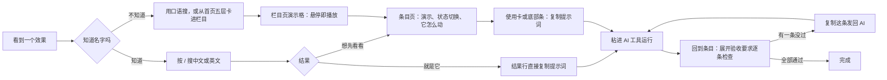
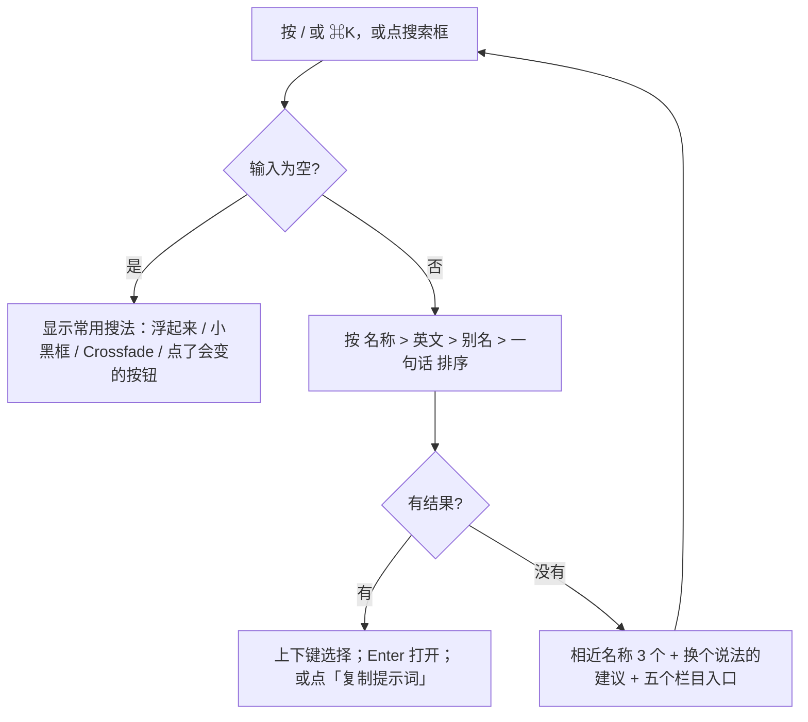

# 产品需求文档：Vibe Design 速查（原「vibocoding助手」）改版

- 文档版本：v1.4（2026-11-11）。v1.0 为初稿；v1.1 写入主人对 10 个待定问题的决定（D1–D10）；v1.2 写入导航样稿评审的 4 项决定（D11–D14）；v1.3 写入视觉方向（D15、D16），新增第 15 节「视觉规范」和第 16 节「交互规范」；v1.4 写入交互的 5 项决定（D17–D21，其中 D19 细化 D11），附一期实施计划 `docs/phase1-plan.md`。决策见第 14 节「决策记录」
- 文档状态：信息架构、视觉和交互均已定，可按 `docs/phase1-plan.md` 开始一期；仅余 1 项待定（第 13.2 节）
- 编写日期：2026-11-11
- 网站名称：改为「Vibe Design 速查」（决策 D8）
- 线上地址：https://zhang-netizen-1.github.io/vibocoding-assistant/
- 代码仓库：`~/Downloads/vibocoding知识梳理`（main 分支，GitHub Actions 自动发布）
- 本文所有现状数字均来自 2026-11-11 的仓库内容（`网页UI元素速查.html`、`动效速查-src/motion_entries.json`、`site-src/guide_pages.py`、`site-src/skill_catalog.py`、`site-src/bench/`），不是估算。

---

## 1. 背景与问题

### 1.1 现状

网站目前叫「vibocoding助手」，定位是「面向 Vibe Coding 初学者的界面速查网站」。顶部导航有 9 个栏目（加首页共 10 个入口）：

| 现有栏目 | 地址 | 条目数 | 内部分组 |
|---|---|---|---|
| UI 元素 | `/ui/` | 70 | 输入 28、反馈 11、导航 13、展示 18 |
| 动效 | `/motion/` | 79（另有「实现规范」分区，不计入） | 页面与视图 6、滚动与空间 10、背景与氛围 5、文字与图形 8、图片与媒介 8、组件与微交互 15、指针与光标 4、导航与浮层 6、数据与状态 11、移动与手势 6 |
| 布局与响应式 | `/layout/` | 6 | 结构与空间 3、适配与密度 3 |
| 视觉风格 | `/visual/` | 6 | 克制与叙事 3、材质与态度 3 |
| 交互规则 | `/interaction/` | 6 | 输入与反馈 3、选择与恢复 3 |
| 页面类型 | `/pages/` | 6 | 呈现与浏览 3、查看与操作 3 |
| 数据可视化 | `/data/` | 6 | 变化与比较 3、分布与明细 3 |
| UI 与交互 Skills | `/skills/` | 10 | 视觉与设计系统 4、交互与可用性 3、审计与验证 3 |
| 测评结果 | `/bench/` | 1 个总览页 + 3 个详情页（按钮、交叉淡化、响应式网格） | — |

合计 189 个条目（70 + 79 + 6×5 + 10），首页搜索框写的也是「搜索全部 189 个条目」。

已有的好东西，改版要保留：

- **每个条目都有可复制的提示词**，默认展开，一键「复制提示词」。
- **大部分条目有真实可操作的演示**（UI 元素的「试一试」、动效的 LIVE DEMO、五类指南卡片的两态切换）。
- **中英文名并列**，英文名可点击复制（如「按钮 / Button」「交叉淡化 / Crossfade」）。
- **稳定锚点**：如 `/ui/#c-button`、`/motion/#e-view-crossfade`、`/layout/#g-layout-grid`，可直达、可复制链接。
- **全站搜索**：首页一个搜索框跨类查找，支持中文或英文名称，Enter 打开首条，Esc 清空。
- **测评结果**：用 Codex 和 Hermes 实测过 3 个条目的提示词，有分数、证据和截图。

### 1.2 问题

**问题一：9 个栏目不是按同一个标准分的。** 每个栏目用的是不同的分类依据：

| 栏目 | 实际的分类依据 |
|---|---|
| UI 元素 | 按「东西」（组件） |
| 动效 | 按「怎么动」（表现手段） |
| 布局与响应式、视觉风格 | 按「设计学科」 |
| 交互规则 | 按「规则」 |
| 页面类型 | 按「页面大小」 |
| 数据可视化 | 按「内容类型」 |
| Skills | 按「工具」 |
| 测评结果 | 按「验证结果」 |

结果是：用户心里想的是一个效果，却要先猜「这东西归哪一类」。比如「卡片鼠标放上去会浮起来」，卡片在 UI 元素里，浮起来在动效里；「提交后按钮显示加载再显示完成」，同时出现在交互规则（提交状态链）和动效（提交反馈状态链）里。

**问题二：同一件事在多处重复，又互不相连。** 现有内容中能确认的重叠：

| 重叠 | 位置 A | 位置 B |
|---|---|---|
| 提交过程的状态 | 交互规则 · 提交状态链（Submission States） | 动效 · 提交反馈状态链（Submission State Flow） |
| 删除后可撤销 | 交互规则 · 撤销操作（Undo Action） | 动效 · 删除退出与撤销（Delete and Undo） |
| 表格排序 | UI 元素 · 表格（Table） | 数据可视化 · 可排序数据表（Sortable Table） |
| 侧栏 | UI 元素 · 侧边栏（Sidebar） | 布局与响应式 · 侧栏工作区（Sidebar Shell） |
| 物体与它的动作 | UI 元素 · 卡片 / 抽屉 / 模态弹窗 / 悬停提示框 / 折叠面板 / 标签页 / 开关 / 下拉菜单 / 轮播图 / 骨架屏 / Toast | 动效 · 卡片悬停上浮 / 抽屉滑入 / 弹窗弹入 / 提示浮现 / 手风琴撑开与收拢 / Tab 选中标记滑移 / 开关滑动 / 菜单展开 / 轮播滑移 / 骨架屏微光 / 通知堆叠进退场 |

目前条目之间没有「相关条目」链接（源码里没有相关条目字段），用户只能自己再搜一次。

**问题三：栏目大小悬殊。** UI 元素 70 条、动效 79 条，另外五类各只有 6 条。小栏目在导航里和大栏目平级，用户点进去发现只有 6 条，会怀疑内容不全；大栏目又太长，一页滚到底很累。

**问题四：「设计基础」几乎是空的。** 想成为设计工程师，最先要懂的是颜色、字体、间距、圆角、阴影这些「设计令牌」（Design Token，把颜色、字号、间距等定成有名字的变量，全站统一引用）。现在站内没有一个条目专门讲它们，只在视觉风格的 6 种风格里间接出现。

**问题五：三套条目结构，三套提示词写法。** 三个来源的字段不一样：

| 来源 | 现有字段 | 提示词写法 |
|---|---|---|
| UI 元素（`网页UI元素速查.html`） | 中文名、英文名、分类、演示、要点（2–3 条）、使用场景、提示词 | 「实现可复用的××组件：……沿用项目现有设计规范。」偏向**新做一个** |
| 动效（`motion_entries.json`，每条 7 项：id、分类、中文名、英文名、触发方式、一句说明、提示词；交叉淡化另有第 8 项测评链接） | 中文名、英文名、触发方式、演示、一句说明、提示词 | 「为当前项目的××加入××：……」偏向**改现有页面** |
| 五类指南（`guide_pages.py`） | 中文名、英文名、一句说明、适合、避免、两态演示、验收句、提示词 | 「请在当前代码仓库中直接实现「××」……实施要求 1/2/3……边界与验收……」最完整 |

只有五类指南有「适合/避免」和「验收」，UI 元素和动效没有「什么时候不要用」，也没有明确的验收句。

**问题六：提示词缺少「验收要求」时，AI 每次做出来可能不一样。** 这是测评台已经测出来的结论，详见第 7 节。

**问题七：搜索只认正式名称。** 搜索框提示「输入中文或英文名称」。用户常说的是口语，例如「点了没反应的那个灰按钮」「弹出来的小黑框」「鼠标放上去浮起来」。目前只有 UI 元素卡片的 `data-name` 里带了少量别名（如按钮带「主要按钮 危险按钮 提交」）；动效的搜索词就是名称加一句说明；指南的搜索词是名称、说明和「适合」。没有统一的别名表。

---

## 2. 产品目标与成功指标

### 2.1 一句话定位

**帮不会写代码、英文不好的人，看见一个界面效果就能叫出它的专业名字，并拿到一段能直接粘进 AI 编程工具、把自己现有页面改成那个样子的提示词。**

### 2.2 四个目标（来自主人的要求）

| 编号 | 目标 | 具体意思 |
|---|---|---|
| G1 | 从最基础帮他查 | 从颜色、字体、间距这些最小单位开始，一层层到组件、交互、整页，零基础也能顺着找 |
| G2 | 帮他去用 | 不只解释概念，要给到「下一步做什么」：复制提示词 → 粘进 AI → 按验收句检查 |
| G3 | 直接看到效果的专业名词（中英文） | 每个效果配实时演示或截图，同时给中文名、英文术语和常见别名 |
| G4 | 可直接复制粘贴进现有页面的提示词 | 提示词默认是「改我现有页面」的写法，粘进 Codex 等工具就能改，不需要用户自己补技术细节 |

### 2.3 成功指标

都写成能检查的形式。上线前用构建测试或人工抽查验证，上线后可以重复测。

| 指标 | 目标值 | 怎么测 |
|---|---|---|
| 条目字段完整率 | 100% 条目具备第 6 节的全部必填字段 | 构建脚本加检查，缺字段构建失败 |
| 口语搜索命中率 | 准备 50 条口语/英文/别名查询，正确条目出现在前 3 条结果 ≥ 90% | 固定查询表写进测试 |
| 从首页到复制提示词的步数 | 已知名称：≤ 2 步（搜索 → 复制）；只知道效果：≤ 4 步（选栏目 → 选分组 → 看演示 → 复制） | 人工走查 |
| 提示词一次达标率 | 带验收句的条目，在测评台重跑时平均分 ≥ 15/16 | 测评台（第 8 节） |
| 提示词稳定性 | 同一条提示词重跑两次，分差 ≤ 1 分 | 测评台重跑 |
| 旧链接不失效 | 现有 189 个锚点和 9 个栏目地址在改版后都能打开到正确内容 | 构建测试逐个检查 |
| 手机可用 | 390px 宽度下所有页面无横向溢出，提示词可复制 | 自动截图检查（测评台已有脚本） |

---

## 3. 用户画像与典型场景

### 3.1 用户画像

**主要用户：想成为「设计工程师」的界面搭建者。**

- 用 Vibe Coding（用自然语言让 AI 写代码）或网页工具做界面，日常工具是 Codex、Claude Code、Hermes 一类 AI 编程助手。
- 很多人（包括主人本人）**没有编程背景，英文阅读吃力**。看得懂效果好不好，但说不出名字、写不出准确要求。
- 痛点：
  1. 看到别人网站的效果，不知道叫什么，没法跟 AI 说清楚；
  2. 跟 AI 说了，AI 做出来「差不多但不对」，不知道哪里不对、怎么让它改；
  3. 同一句话这次做对了，下次又变了。

**次要用户：** 已有前端基础、想快速找标准说法和验收要点的人；协作者（通过条目直达链接被分享过来）。

### 3.2 典型场景

| 场景 | 用户说的话 | 站点要做到 |
|---|---|---|
| S1 看到一个效果想要 | 「我想要那种鼠标放上去卡片会浮起来的效果」 | 搜「浮起来」命中「卡片悬停上浮 / Hover Lift」，演示一看就确认 |
| S2 已知名字查做法 | 「Crossfade 怎么AI 实现」 | 搜英文直达，复制提示词 |
| S3 改现有页面 | 「我页面上的按钮太丑，想统一改好」 | 条目提供「改现有页面」版提示词，粘进 Codex 直接改 |
| S4 AI 做完了要检查 | 「它说做好了，我怎么知道对不对」 | 条目给出验收句，一条条对照检查 |
| S5 从零学 | 「我想系统学一下，从哪看起」 | 首页按「从小到大」的五层顺序引导 |
| S6 选 AI 工具和装技能 | 「哪个 AI 做按钮更靠谱」「有什么技能能让 AI 设计更好」 | 「AI 实现」栏目：测评结果 + Skills |

### 3.3 核心任务流

```
看到一个效果
  → 找到名词：搜索中文口语 / 英文术语 / 别名，或按五层目录浏览
  → 看演示：在条目里亲手操作，确认「就是这个」
  → 复制提示词：默认是「改现有页面」版，已含验收要求
  → 粘进 Codex 等 AI 工具：在自己的项目里运行
  → 验收：照条目里的验收句逐条检查；不对就把没达标的那句再发给 AI
```

每一步站点都要给到下一步的入口，不让用户卡住：

- 搜不到时，给出「你可能要找的」推荐；
- 演示旁边就是提示词；
- 提示词下面就是验收句；
- 有测评的条目挂「测评结果 →」，告诉用户这条提示词实测效果如何。

---

## 4. 核心功能

### 4.1 名词查询

**F1 全站搜索（升级现有首页搜索）**

- 查询来源有三种：
  - 中文正式名（按钮）；
  - 英文术语（Button），大小写和空格不敏感；
  - 别名和口语（主要按钮、提交按钮、点了会动的按钮）。
- **新增别名字段**：每个条目维护 3–10 个别名，由人工整理（不由 AI 现编），放进条目源数据，构建时写入搜索索引。别名包括：
  - 常见口语；
  - 其他产品的叫法（例如 Toggle / Switch，Dialog / Modal）；
  - 常见错别字或近义词。
- **结果排序**：正式名完全匹配 > 英文完全匹配 > 别名匹配 > 说明文字匹配。每条结果显示中文名、英文名、所属栏目和一句话解释。
- **搜不到时**：显示「没有找到，试试这些」：同栏目的热门条目，不设反馈入口（D9，见第 10 节非目标）。
- **全站可用**：不只首页，每个栏目页顶部都有同一个搜索框。快捷键 `/` 聚焦（首页现已支持）。

**F2 中英对照**

- 每个条目都有：中文名、英文名（可点击复制，现有功能保留）、别名。
- 页面上第一次出现的专业词，后面用括号附一句白话解释（例如「设计令牌（把颜色、间距等定成有名字的变量）」）。
- 全站维护一份「名词小抄」（测评页已有此做法）。

### 4.2 效果展示

**F3 实时演示（保留并统一）**

- 能用网页原生代码演示的，一律做成可操作的实时演示（现有大部分条目已是）。
- 演示上方用一行字说明怎么操作，例如「试一试：点击有反馈」「点击切换」（现有做法保留）。
- 需要两种状态对比的（如宽布局 / 窄布局），用切换按钮（现有五类指南做法），并推广到需要对比的组件条目。
- 做不成实时演示的（例如 3D、真实照片场景），用截图或短视频，并标注「截图示意」。
- 遵守「减弱动态」（Reduced Motion，用户在系统里关掉动画时，演示改为直接切换）。

### 4.3 提示词复制

**F4 两个版本的提示词**（已定 D7）

- **「改现有页面」版（默认展示）**：开头先让 AI 找到项目里已有的对应部分再改，例如「在当前项目中找到所有按钮……统一改成……」。这是 G4 的核心。
- **「新做一个」版（折叠）**：用于项目里还没有这个东西的情况，对应现有 UI 元素的「实现可复用的××组件」写法。
- 两个版本末尾都带「验收要求」（第 7 节）。
- 「复制提示词」按钮保留。复制成功后，按钮短暂显示「已复制」，然后恢复，按钮尺寸不变（这一条本身就是测评过的验收要求）。

**F5 验收句默认收起、可单独复制**（D13）

- 条目里的「验收要求」默认收起，只显示标题和条数，例如「验收要求（5 条）· 点击展开」。这样条目不会太长，手机上尤其明显。
- 点开后逐条列出，每条旁边有「复制这条」。AI 做完后，用户常需要把「没达标的那一条」单独发回去。
- 提示词正文里，验收要求的位置显示一行「共 5 条，见下方验收要求；复制提示词时自动包含」。点「复制提示词」复制的是**含全部验收要求的完整提示词**，收起与否不影响复制内容。

**F6 直达与分享（保留）**

每个条目保留「# 直达此条」和「复制链接」。

---

## 5. 信息架构与分类方案

### 5.1 唯一分类轴：从小到大搭一个界面

只用一个分类标准：**一个界面从小到大是怎么搭起来的。** 「AI 实现」单独放在最后，因为它讲的是「怎么用工具」，不是界面本身。

| 顺序 | 新栏目 | 讲什么 | 一句话判断 |
|---|---|---|---|
| 1 | 设计基础 | 颜色、字体、间距、圆角阴影、风格、网格与断点 | 还不是任何具体东西，是所有东西共用的「材料和规矩」 |
| 2 | 组件 | 按钮、表单、卡片、表格、图表……以及它们的各种状态 | 页面上一个个能指出来的「东西」 |
| 3 | 交互与动效 | 东西怎么响应操作、怎么动、怎么反馈 | 「东西的行为」 |
| 4 | 页面与场景 | 落地页、仪表盘、详情页、设置页…… | 很多东西组合成的一整页 |
| 5 | AI 实现 | 提示词写法、测评结果、AI 技能（Skills） | 怎么让 AI 把上面这些做对 |

### 5.2 交叉条目的归属规则

一个效果往往既是「东西」又是「行为」。规则是：

1. **东西放它所在的层**：卡片放「组件」，网格放「设计基础」，仪表盘放「页面与场景」。
2. **行为放「交互与动效」**：卡片悬停上浮、抽屉滑入、提交状态链都放「交互与动效」。
3. **两边互相链接**：「卡片」条目底部列出「相关动效：卡片悬停上浮、卡片跟手倾斜、卡片聚光跟随、翻面卡片、卡片原位展开详情、整卡可点击」；「卡片悬停上浮」条目底部链回「卡片」。
4. **真正重复的合并成一条**：两个条目讲的是同一件事时（例如提交状态链和提交反馈状态链），合并成一个条目，把交互规则和动效写法都收进去。旧锚点跳到合并后的条目。是否合并逐对由主人确认（第 13 节）。
5. **判断不了时**：问「用户找它时，脑子里先想到的是一个东西还是一个动作？」先想到东西就放组件，先想到动作就放交互与动效。

### 5.3 新栏目内部分组

**1 设计基础（12 条，三期新增 5 条后为 17 条）**

- 基础令牌：颜色与对比度、字体与字号、间距、圆角与阴影、深色模式（现有 0 条，三期新增 5 条，D4）
- 视觉风格：6 条（原「视觉风格」）
- 网格与断点：6 条（原「布局与响应式」）

**2 组件（75 条）**

- 按钮与操作 5
- 表单与输入 23
- 反馈与浮层 11
- 导航与菜单 12
- 内容展示 10
- 表格与列表 9
- 图表 5

**3 交互与动效（84 条，另含实现规范）**

- 交互规则 7：原 6 条 + 自动保存（其中「提交状态链」「撤销操作」各并入了一条动效，见 D2）
- 动效 77：沿用现有 10 个分组；「数据与状态」由 11 条减为 9 条（提交反馈状态链、删除退出与撤销并入交互规则）
- 动效实现规范：现有分区，不计入条目数

**4 页面与场景（6 条）**

原「页面类型」6 条。

**5 AI 实现（10 条 + 测评报告）**

- AI 技能（Skills）10
- 测评结果：总览 + 3 个详情
- 提示词写法：新增说明页，不计条目，见 5.5

合计：12 + 75 + 84 + 6 + 10 = **187**。现有 189 条，合并两对重复条目后为 187 条（D2）。三期再新增 5 条基础令牌（D4），届时为 192 条。

### 5.4 旧→新完整对照表

#### 5.4.1 栏目级

| 旧栏目（条目数） | 新栏目 · 分组 | 说明 |
|---|---|---|
| UI 元素（70） | 组件（69）+ 交互与动效 · 交互规则（1：自动保存） | 按新的 7 个组件分组重排 |
| 动效（79） | 交互与动效 · 动效（77）；提交反馈状态链、删除退出与撤销 2 条并入交互规则 | 10 个分组不变（D2） |
| 动效 · 实现规范（不计数） | 交互与动效 · 实现规范；其中两节留在原处，从「AI 实现 · 提示词写法」链接过来 | D6 |
| 布局与响应式（6） | 设计基础 · 网格与断点（6） | |
| 视觉风格（6） | 设计基础 · 视觉风格（6） | |
| 交互规则（6） | 交互与动效 · 交互规则（6） | |
| 页面类型（6） | 页面与场景（6） | |
| 数据可视化（6） | 组件 · 图表（5）+ 组件 · 表格与列表（1：可排序数据表） | 现有数据可视化 6 条都是单个图表或表格，没有「看板」条目；看板对应的是页面类型里的「仪表盘」，它留在页面与场景 |
| UI 与交互 Skills（10） | AI 实现 · AI 技能（10） | |
| 测评结果（4 页） | AI 实现 · 测评结果 | 同时在条目上挂徽标（第 8 节） |

#### 5.4.2 条目级：UI 元素 70 条

| 旧分组 | 条目 | 新归属 |
|---|---|---|
| 输入 | 按钮、分裂按钮、长按确认 | 组件 · 按钮与操作 |
| 输入 | 输入框、文本域、下拉框、复选框、单选按钮、开关、滑动条、数字输入框、日期选择器、颜色选择器、星级评分、搜索框、自动补全、分段控件、密码强度、标签输入、验证码输入、上传区域、表单、原地编辑、条件步骤、高级设置、上下文选项（23） | 组件 · 表单与输入 |
| 输入 | 命令面板 | 组件 · 导航与菜单 ⚠ |
| 输入 | 自动保存 | 交互与动效 · 交互规则 ⚠ |
| 反馈 | 进度条、模态弹窗、Toast / 通知、组件状态、悬停提示框、提示横幅、加载中、骨架屏、空状态、侧滑抽屉、浮层（11） | 组件 · 反馈与浮层（组件状态 ⚠） |
| 导航 | 顶部导航栏、侧边栏、标签页、折叠面板、面包屑导航、分页、步骤条、页脚、下拉菜单、大型菜单、右键菜单（11） | 组件 · 导航与菜单 |
| 导航 | 悬浮按钮、返回顶部 | 组件 · 按钮与操作 |
| 展示 | 标签 / 徽章、标签（可删除）、卡片、整卡可点击、轮播图、通知角标、时间线、统计卡片、头像、视图切换（10） | 组件 · 内容展示 |
| 展示 | 表格、表格固定表头与固定列、列宽拖拽与列显隐、拖动列排序、单元格编辑、无限滚动、加载更多、虚拟列表（8） | 组件 · 表格与列表（无限滚动 ⚠） |

#### 5.4.3 条目级：动效 79 条

全部进入「交互与动效 · 动效」，10 个分组不变：

- 页面与视图 6
- 滚动与空间 10
- 背景与氛围 5 ⚠
- 文字与图形 8
- 图片与媒介 8
- 组件与微交互 15
- 指针与光标 4
- 导航与浮层 6
- 数据与状态 9（原 11 条；提交反馈状态链、删除退出与撤销并入交互规则，D2）
- 移动与手势 6

需要与组件互链的（东西 ↔ 行为）：

| 组件条目 | 相关动效条目 |
|---|---|
| 卡片 | 卡片悬停上浮、卡片跟手倾斜、卡片聚光跟随、翻面卡片、卡片原位展开详情、悬停预览、悬停操作栏 |
| 按钮 | 按压回弹、按钮形态切换、磁吸按钮、点击涟漪 |
| 开关 | 开关滑动 |
| 折叠面板 | 手风琴撑开与收拢 |
| 标签页 | Tab 选中标记滑移、下划线展开 |
| 下拉菜单 / 大型菜单 | 菜单展开 |
| 侧滑抽屉 | 抽屉滑入、底部弹层上推 |
| 模态弹窗 | 弹窗弹入 |
| 悬停提示框 / 浮层 | 提示浮现 |
| Toast / 通知 | 通知堆叠进退场 |
| 轮播图 | 轮播滑移、跟手翻页 |
| 骨架屏 | 骨架屏微光、骨架屏到内容接力 |
| 统计卡片 | 数字递增、数字滚轮翻牌 |
| 图表（5 条） | 图表生长、图表数据更新变形 |
| 表格 / 列表 | 列表平滑重排、筛选后平滑重组、拖拽排序、滑动删除 |
| 顶部导航栏 | 滚动压缩页头、滚动隐藏页头 |
| 进度条 | 阅读进度反馈（不是同一件事，仅作对照链接） |

#### 5.4.4 条目级：五类指南 30 条

| 旧栏目 · 分组 | 条目 | 新归属 |
|---|---|---|
| 布局 · 结构与空间 | 响应式网格 | 设计基础 · 网格与断点 |
| 布局 · 结构与空间 | 侧栏工作区、主次分栏 | 设计基础 · 网格与断点 ⚠ |
| 布局 · 适配与密度 | 容器内适配、信息密度 | 设计基础 · 网格与断点 |
| 布局 · 适配与密度 | 吸顶阅读区 | 设计基础 · 网格与断点 ⚠ |
| 视觉 · 克制与叙事 | 极简主义、编辑式排版、自然有机 | 设计基础 · 视觉风格 |
| 视觉 · 材质与态度 | 玻璃拟态、新粗野主义、新拟态 | 设计基础 · 视觉风格 |
| 交互 · 输入与反馈 | 字段就地校验 | 交互与动效 · 交互规则 |
| 交互 · 输入与反馈 | 提交状态链、撤销操作 | 交互与动效 · 交互规则 ⚠（与动效重复） |
| 交互 · 选择与恢复 | 批量选择、乐观更新、键盘焦点 | 交互与动效 · 交互规则（键盘焦点 ⚠） |
| 页面 · 呈现与浏览 | 落地页、仪表盘、结果列表页 | 页面与场景 |
| 页面 · 查看与操作 | 详情页、设置页、分步表单 | 页面与场景（分步表单 ⚠） |
| 数据 · 变化与比较 | 趋势折线、柱状对比、构成堆叠 | 组件 · 图表 |
| 数据 · 分布与明细 | 占比环图、热力矩阵 | 组件 · 图表 |
| 数据 · 分布与明细 | 可排序数据表 | 组件 · 表格与列表 ⚠（与 UI「表格」重复） |

#### 5.4.5 条目级：Skills 10 条

全部进入「AI 实现 · AI 技能」，分组不变：

- 视觉与设计系统 4：前端视觉设计、UI/UX 设计检索、界面基础打磨、提取设计规范
- 交互与可用性 3：无障碍交互修复、动效性能修复、React 视图转场
- 审计与验证 3：Web 界面规范审计、真实浏览器测试、React 组件组合

#### 5.4.6 有歧义的条目（⚠）与归属

下表归属已全部由主人确认（D5），按表执行。

| 条目 | 为什么有歧义 | 建议归属 | 理由 |
|---|---|---|---|
| 自动保存（UI · 输入） | 页面上看不到一个具体的「东西」，是一种行为 | 交互与动效 · 交互规则 | 用户想到它时先想到的是「它自己会存」这个动作；从「表单」条目链过来 |
| 命令面板（UI · 输入） | 有输入框，但用途是找功能、跳转 | 组件 · 导航与菜单 | 用户用它来「去某处 / 做某事」，和菜单同类；从「搜索框」互链 |
| 组件状态（UI · 反馈） | 它讲的是所有组件共有的状态，不是一个具体组件 | 组件 · 放在组件栏目首位，作为「先看这一条」 | 状态是组件的组成部分，放在开头相当于组件的总说明；与「键盘焦点」互链 |
| 无限滚动（UI · 展示） | 既是列表形态，也是滚动行为 | 组件 · 表格与列表 | 和「加载更多」「虚拟列表」放一起，方便对比三种长列表方案；从「滚动与空间」互链 |
| 背景与氛围 5 条（动效） | 极光渐变等既是动画，也是视觉风格 | 交互与动效 · 动效 | 都是「会动的背景」，核心是动；从「视觉风格」各条目链过来 |
| 侧栏工作区、主次分栏（布局） | 接近整页结构 | 设计基础 · 网格与断点 | 讲的是空间怎么分、窄屏怎么变，属于版面骨架；从「仪表盘」「详情页」互链；与 UI「侧边栏」互链（侧边栏是东西，侧栏工作区是版面） |
| 吸顶阅读区（布局） | 和动效「滚动压缩页头」「滚动隐藏页头」很近 | 设计基础 · 网格与断点 | 它讲「什么留在顶部」的版面规则，后两者讲「怎么动」；三者互链 |
| 提交状态链 ↔ 提交反馈状态链 | 同一件事两处写 | **已定（D2）**：合并为一条，放交互与动效 · 交互规则 | 规则和动画一起讲才完整；动效旧锚点跳转过来 |
| 撤销操作 ↔ 删除退出与撤销 | 同上 | **已定（D2）**：合并为一条，放交互与动效 · 交互规则 | 同上 |
| 表格 ↔ 可排序数据表 | 两处都讲表格排序 | **已定（D3）**：保留两条：「表格」为总条目，「可排序数据表」改为它的一种用法，放在相邻位置并互链 | 可排序数据表的演示和验收（数值按数值比较、窄屏可横向滚动）是有价值的独立内容 |
| 键盘焦点（交互） | 所有组件都要有焦点样式 | 交互与动效 · 交互规则 | 它讲的是焦点怎么移动、怎么看得见（行为）；从「组件状态」和按钮链过来 |
| 分步表单（页面类型） | 与 UI「步骤条」「条件步骤」接近 | 页面与场景 | 它是整个流程的页面组织；步骤条（组件）和条件步骤（组件）互链 |

### 5.5 「AI 实现 · 提示词写法」（新增说明页）

把现在分散的「怎么跟 AI 说」集中起来，内容来自：

- 动效实现规范里的「四层结构：怎么向 AI 描述一个动效」和「触发描述五步检查」（已定 D6：留在动效实现规范原处，提示词写法页只做摘要和链接）；
- UI 元素页顶部的「结构怎么读：形态与变体 → 状态 → 可配置项 → 交互约束 → 沿用项目规范」；
- 测评结论（第 7 节）。

---

## 6. 条目标准内容结构

### 6.1 字段表

所有条目统一成一套字段，三个来源（UI 元素 HTML、动效 JSON、指南 Python）改版时都迁移到同一数据结构。

| 字段 | 必填 | 说明 | 现状 |
|---|---|---|---|
| `id` 稳定锚点 | 是 | 沿用现有 id（如 `c-button`），新条目按规则命名 | 全部已有 |
| 中文名 | 是 | 业内最常用的中文叫法 | 全部已有 |
| 英文名 | 是 | 英文术语；有多种叫法用「/」分隔（如 Switch / Toggle） | 全部已有 |
| 别名 | 是（≥3 个） | 口语、他处叫法、近义词，进入搜索 | 仅 UI 元素有少量 |
| 一句话解释 | 是 | ≤ 30 字，说它「是什么、干什么」，不用术语或给术语附解释 | 已有（UI 的「使用场景」、动效的「一句说明」、指南的「说明」） |
| 实时效果或截图 | 是 | 可操作演示优先；附一行操作提示 | 已有 |
| 何时用 | 是 | 2–3 个典型场景 | UI 元素有「使用场景」，指南有「适合」，动效没有 |
| 何时不用 | 是 | 1–2 个反例 | 只有指南有「避免」 |
| 关键参数 | 视条目 | 影响效果的几个数，如时长、缓动、间距、断点、对比度；给推荐范围 | 动效实现规范里有通用参数，条目里没有 |
| 提示词 ·「改现有页面」版 | 是 | 默认展示（第 7 节） | 动效接近，UI 和指南偏新建 |
| 提示词 ·「新做一个」版 | 是 | 折叠展示 | UI 元素现有提示词可作为基础 |
| 验收要求句 | 是（≥3 条） | 每句可检查、有数字或明确判据；条目页默认收起，可逐条复制（D13） | 只有指南有 1 句「验证关键结果」 |
| 所属分类 | 是 | 新栏目 + 分组 | 需重新标注 |
| 相关条目 | 是（≥1 个） | 东西 ↔ 行为互链，以及同组可对比的条目 | 没有 |
| 测评链接 | 有测评时 | 「测评结果 →」徽标 + 分数摘要 | 3 条已有 |

### 6.2 完整示例：按钮

以现有「按钮」条目为底。其中验收要求来自测评台第 2 轮实测（加上后两个 AI 都从 12–13 分提到 16 分）。

> **按钮** · Button
> 别名：主要按钮、次要按钮、危险按钮、提交按钮、操作按钮、CTA、Primary Button
> 所属：组件 · 按钮与操作
> 测评：Codex 13→16，Hermes 12→16（[测评结果 →](/bench/button/)）
>
> **一句话**：用户点一下就触发一个动作，比如提交、保存、删除。
>
> **演示**：试一试：点击有反馈。可操作：主要 / 次要 / 危险 / 复制链接 四个按钮。
>
> **何时用**：提交表单、保存、确认、跳转到下一步；需要成功反馈的复制类操作。
> **何时不用**：只是去另一个页面且不触发动作时，用链接；一组并列选项中选一个时，用分段控件或单选按钮。
>
> **关键参数**：
> - 点击区域至少 24×24px（测评所用的底线）；手机上建议 44×44px，手指才能点准
> - 文字与底色对比度 ≥ 4.5:1
> - 焦点环与旁边背景对比度 ≥ 3:1
> - 成功提示停留约 1.5–2 秒后恢复
>
> **提示词（改现有页面）**：
> ```
> 在当前项目中找到所有按钮，统一改成一套可复用的按钮组件，并替换原来的写法：
> 支持主要、次要、危险三种用途样式，以及悬停、按下、聚焦、禁用、加载状态；
> 按钮文字与点击行为保持原样，禁用或加载中不可重复触发；复制类操作完成后按钮短暂显示成功状态再恢复。
> 沿用项目现有的颜色、字体和间距；不要改动按钮以外的页面内容和业务逻辑。
>
> 验收要求（条目页上默认收起，见 F5；复制提示词时完整包含）：
> 1. 按下态必须和悬停态在颜色上能看出区别，不能只靠位移。
> 2. 键盘聚焦时的焦点环，与它旁边的背景对比度至少 3:1。
> 3. 所有颜色、圆角、间距先定义成 CSS 变量（设计令牌），组件里只引用变量，不写死色值。
> 4. 状态切换时（包括复制成功）按钮尺寸保持不变，周围内容不跳动。
> 5. 加载中的按钮文字仍然清楚可读（文字与底色对比度至少 4.5:1）。
>
> 完成后列出改了哪些文件，并说明以上 5 条各自是怎么验证的。
> ```
>
> **提示词（新做一个，折叠）**：实现可复用的按钮（Button）组件：支持主要、次要、危险三种用途样式，以及悬停、聚焦、禁用、加载状态；按钮文字与点击行为可配置，禁用或加载中不可重复触发；复制类操作完成后按钮短暂显示成功状态再恢复。沿用项目现有设计规范。（后接同样的 5 条验收要求）
>
> **相关条目**：
> - 组件状态（先看）、键盘焦点、分裂按钮、长按确认、悬浮按钮；
> - 动效：按压回弹、按钮形态切换、磁吸按钮、点击涟漪。

---

## 7. 提示词设计规范

### 7.1 测评得出的核心结论

测评台用同一套提示词让 Codex 和 Hermes 各做了两轮，并用脚本和截图逐项打分（每条目 8 项 × 2 分 = 16 分）。

| 条目 | 第 2 轮改了什么 | Codex | Hermes |
|---|---|---|---|
| 按钮 | 加了 5 条「补充验收要求」 | 13 → 16 | 12 → 16 |
| 响应式网格 | 加了 5 条「补充验收要求」 | 12 → 16 | 14 → 16 |
| 交叉淡化 | 不改，原样重跑（测稳定性） | 16 → 16 | 16 → 13 |

**结论：写进提示词的要求很稳，没写的每次可能变。**

- **加验收要求后**，两个 AI 在按钮和网格上都到了满分。失分的点正好是第 1 轮没写明的要求：
  - 按钮：按下态和悬停态颜色一样；焦点环对比度只有 1.59:1 和 2.38:1；颜色写死不走变量；Hermes 复制成功时按钮宽度在 95px 和 107px 间跳动。
  - 网格：Codex 在 760px 是 3 列、800px 反而变回 2 列；横纵间距不一致且写死；Codex 遇到超长标题和超高图片时，整页出现横向溢出。
- **同一条提示词不改、原样重跑**，Codex 两次都是 16 分；Hermes 从 16 掉到 13。掉分的三项（时长 420ms 超出 400ms 上限、缓动用分段直线拼出来有折点、连点时冻结出叠影）都是原提示词里**没有写成数字或判据**的地方。
- **代价**：提示词变长后更费时。按钮条目 Codex 433 秒 → 808 秒，Hermes 330 秒 → 655 秒，接近 2 倍；网格变化不大。

### 7.2 规范

1. **每条提示词必须带「验收要求」**，3–6 条。每条要么有数字（对比度 ≥ 3:1、时长 ≤ 400ms），要么有明确判据（「屏幕变宽时绝不能反而变少列」）。不写「好看」「流畅」「合适」这类无法检查的词。
2. **用户最在意、AI 最容易做错的，一定写进验收要求。** 来源有三：测评失分项；无障碍底线（对比度、焦点、点击区域、减弱动态）；不跳动、不溢出。
3. **默认写成「改现有页面」**，固定结构：
   1. 先找到项目里的对应部分；
   2. 说要改成什么（形态与变体 → 状态 → 可配置项 → 交互约束）；
   3. 沿用项目现有的颜色、字体和间距；
   4. 不要改动与此无关的内容；
   5. 验收要求；
   6. 完成后列出改动文件，并逐条说明怎么验证。
4. **不绑定某一个 AI 工具**：不写工具专属指令，Codex、Claude Code、Hermes 都能直接用。
5. **长度取舍**：验收要求会让 AI 多花时间（实测最多约 2 倍）。只写真正会出错的点，不堆砌。
6. **术语附白话**：提示词里出现「设计令牌」「对比度」「缓动」等词时，后面括号写一句白话。这样用户看得懂，AI 也不受影响。
7. **测评反哺**：一条提示词被测出新的失分点，就把对应的验收句补进去，并在条目上更新测评结果（第 8 节）。

---

## 8. 测评结果如何融入

1. **归入「AI 实现」**：「测评结果」成为「AI 实现」下的一个分组。包括：
   - 总览：主结论、分数对比、用时、方法、局限；
   - 每个被测条目一页详情。

   现有 4 页内容和地址（`/bench/`、`/bench/button/`、`/bench/crossfade/`、`/bench/grid/`）保留。
2. **条目上挂徽标**：被测过的条目在标题旁显示「测评结果 →」（现已在按钮、交叉淡化、响应式网格 3 条上实现）。改版后徽标旁加分数摘要，例如「Codex 16 · Hermes 16」。
3. **测评反哺提示词**：测评失分项 → 写成验收句 → 补进条目提示词 → 下一轮测评验证。每次测评后，在条目上记录「当前提示词版本已于 ×月×日 测过」。
4. **评分方式标明**：分数分「工具实测」（脚本在浏览器里量）和「助手目测判定」（看截图判定）两类，页面上保持区分（现已实现）。
5. **只放真实结果**：没测过的条目不挂徽标、不写预计分数。

---

## 9. 导航与入口设计

### 9.1 顶部导航

- 从现在的 10 个入口（首页 + 9 栏目）收为 **6 个**：首页、设计基础、组件、交互与动效、页面与场景、AI 实现。
- 左侧品牌名改为「Vibe Design 速查」（D8），不加英文副标（第 15.4 节不用装饰性英文标签）。
- 样稿：`docs/mockups/nav-v3.html`（v1.4 定稿样稿：首页、组件栏目页、按钮条目页、搜索、手机目录）；上一版 `nav-v2.html` 保留作对比。
- 导航顺序就是「从小到大」的学习顺序，栏目名前加序号 01–05，让用户感知层级。
- **桌面端用大下拉（Mega Menu，一次展开整块的大菜单）**（D11）：鼠标悬停或点击栏目，展开整块面板，列出该栏目全部分组和每组条目数，**不列具体条目**（D19；如组件 → 先看：组件状态；按钮与操作 5 / 表单与输入 23 / ……）。点分组进入栏目页并滚到该分组；具体条目交给栏目页的演示格。键盘可操作：Tab 移动、Enter 打开、Esc 关闭；点击面板外关闭。
- **手机端用右侧滑出的目录抽屉**（D12）：见 9.5。

### 9.2 首页

- 第一屏：一句话定位 + 条目总数「187」 + 全站搜索框（现有）+ 3–5 个口语搜索示例，例如「鼠标放上去浮起来」「弹出来的提示框」「Crossfade」。
- 首页只显示当前条目总数，不显示「189 → 187 条 · 合并两对重复」之类的改版说明（D14）。改版过程记录在本文档和 README 里，不放在用户界面上。
- 第二屏：五层目录卡片（替换现在的 8 张分类卡片），每张写清这一层讲什么、有多少条、从哪条开始看。
- 第三屏：「怎么用」四步：找到效果 → 看演示 → 复制提示词 → 粘进 AI 并验收。附测评主结论一句，链到测评结果。

### 9.3 搜索

见 4.1。每个栏目页顶部都有搜索框；搜索结果显示所属栏目，跨栏目也能直达。

### 9.4 条目内互链

- 每个条目底部有「相关条目」，按「相关组件 / 相关动效 / 可对比」分组列出。
- 被合并或移动的旧条目，旧锚点继续有效（见 9.6）。

### 9.5 手机端

- 390px 宽度下：所有页面无横向溢出；宽表格在自己的框内横向滑动（测评页已是此做法）。
- 顶部导航收成「品牌 + 搜索图标 + 目录按钮」。点「目录」，从**屏幕右侧滑出**目录抽屉（D12）；五个栏目在抽屉里折叠，点开显示分组。抽屉打开时背景不能滚动；按关闭按钮、点遮罩或按 Esc 都能关闭，关闭后焦点回到「目录」按钮。
- 条目演示区高度受限；「改现有页面」提示词默认展开、复制按钮足够大；验收要求默认收起（D13）。
- 依赖鼠标的演示（如光标跟随、悬停），在手机上给出替代说明或点按触发。

### 9.6 旧地址兼容

- 8 个旧栏目地址（`/ui/`、`/motion/`、`/layout/`、`/visual/`、`/interaction/`、`/pages/`、`/data/`、`/skills/`）在改版后保留为跳转页：带着原来的 `#锚点` 跳到新的条目页（D17）。`/bench/` 一期不搬家，地址不变。具体规则见 `docs/phase1-plan.md` 第 4 节。
- 理由：README、测评页、已分享出去的链接都在用旧地址。

---

## 10. 非目标（本次不做）

- 不做后端、账号、收藏同步、评论（保持纯静态网站，继续用 GitHub Pages 发布）。
- 不在站内直接调用 AI 生成或修改代码，只提供提示词。
- 不做英文版界面（英文只作为术语出现）。
- 不追求条目数量。改版阶段只调整归属、合并两对重复条目（189 → 187）、补齐字段；新增仅限三期的 5 条基础令牌。
- 暂不设用户反馈入口（如「搜不到时告诉我们」）（D9）。
- 不做深色外观和深浅色切换（D16）。视觉按第 15 节重做，原 `docs/design-system.md`「工程终端」v3 不再沿用，改版时同步更新该文件。
- 不对所有条目做测评。测评按分期逐步扩展，先测高频组件。
- 不把 DSH 纳入测评（已确定放弃）。

---

## 11. 分期计划

| 期 | 内容 | 交付 | 条目数变化 |
|---|---|---|---|
| 一期：换骨架 | 新视觉（第 15 节）；条目独立页、全站搜索浮层、10 个组件的状态切换（D17–D21）；新五层导航和首页；网站改名「Vibe Design 速查」；189 条按第 5.4 节重新归类；合并两对重复条目；旧地址跳转（含被合并条目的旧锚点）；相关条目互链（先做 5.4.3 表中的组件 ↔ 动效） | 新 IA 上线，所有旧链接可用 | 189 → 187 |
| 二期：统一条目 | 三套源数据迁移成统一字段；补别名、何时用/不用；所有提示词改成「改现有页面」默认版 + 「新做一个」版；每条补 ≥3 条验收句；口语搜索测试表上线 | 字段完整率 100%，口语搜索命中率达标 | 不变（187） |
| 三期：补基础 | 新增「设计基础 · 基础令牌」5 条：颜色与对比度、字体与字号、间距、圆角与阴影、深色模式（D4）；「提示词写法」说明页 | 零基础入门路径完整 | 187 → 192 |
| 四期：扩测评 | 把测评扩展到更多条目（测哪些、用哪些 AI 待定，见 Q10），测评结果反哺提示词 | 更多条目挂上测评徽标 | 不变 |

每期都单独开分支开发，主人验收后再合并发布（沿用本次测评结果栏目的做法）。一期的具体步骤、顺序、风险、旧地址跳转和验证方法见 `docs/phase1-plan.md`（v1.4 起，一期同时包含新视觉和条目独立页，因为 D17 定下栏目页只放演示格，没有条目页就无法上线）。

---

## 12. 验收标准

以下每条都能检查，大部分可以写进 `tests/test_site_build.py` 或测评台脚本。

**信息架构**

- [ ] 顶部导航为 6 个入口：首页 + 5 个栏目，顺序为设计基础、组件、交互与动效、页面与场景、AI 实现。
- [ ] 桌面端每个栏目都有大下拉，列出全部分组和条目数；能用键盘打开，按 Esc 关闭。
- [ ] 手机端（≤ 760px）的目录从右侧滑出；打开时背景不能滚动，关闭后焦点回到「目录」按钮。
- [ ] 首页只显示「187」，不出现「189 → 187」等改版说明。
- [ ] 一期、二期后条目总数为 187（189 减去 D2 合并的 2 条）；三期后为 192（加 D4 的 5 条）。
- [ ] 网站名称在导航、首页、页面标题中均为「Vibe Design 速查」。
- [ ] 被合并的 2 个动效条目旧锚点（提交反馈状态链、删除退出与撤销）跳到合并后的交互规则条目。
- [ ] 每个条目只属于一个新栏目和一个分组。
- [ ] 5.4 节表中每个条目都在其新归属位置能找到。

**旧链接**

- [ ] 9 个旧栏目地址都能打开，并带着锚点跳到对应条目。
- [ ] 现有全部条目锚点（如 `/ui/#c-button`、`/motion/#e-view-crossfade`、`/layout/#g-layout-grid`）跳转后都落在正确条目上。

**条目字段**

- [ ] 每个条目都具备 6.1 节所有必填字段，缺失时构建失败。
- [ ] 每条提示词都包含「验收要求」，且不少于 3 条。
- [ ] 每个条目至少有 1 个「相关条目」，且链接都能打开。
- [ ] 5.4.3 节表中的组件 ↔ 动效互链全部存在，且是双向的。

**搜索**

- [ ] 50 条固定口语、英文和别名查询中，≥ 90% 在前 3 条结果命中正确条目。
- [ ] 英文查询大小写不敏感。
- [ ] 每个栏目页都有搜索框。

**提示词**

- [ ] 「复制提示词」复制的是完整提示词：正文 + 全部验收要求 + 结尾的验证说明，与验收要求是否展开无关。
- [ ] 复制成功后有反馈，且按钮尺寸不变。
- [ ] 条目里的验收要求默认收起，点击后展开；展开后每条都能单独复制。

**视觉（第 15 节）**

- [ ] 网站外框只出现第 15.3 节表中的颜色；没有其他品牌色、渐变或装饰色。
- [ ] 演示里不出现 `#1D4ED8`；演示主色和网站链接蓝在评审截图里一眼能分开。
- [ ] 所有文字对比度 ≥ 4.5:1，控件边框和焦点环 ≥ 3:1；`#6B7280` 不出现在 `#F3F4F6` 上。
- [ ] 不出现装饰性英文大写标签；最小字号 12px。
- [ ] 没有深色主题和切换开关。

**交互（第 16 节）**

- [ ] 任何页面按 `/` 或 `⌘/Ctrl+K` 都能打开搜索；Esc 关闭后焦点回到原处。
- [ ] 第 16.1 节的 10 个测试搜索词都能搜到对应条目（现在有 5 个零结果）。
- [ ] 搜不到时显示相近名称、换说法建议和栏目入口，不出现反馈入口。
- [ ] 条目页在 1440、768、390 三种宽度下，不滚动就能点到「复制提示词」（桌面使用卡，窄屏底部操作条）。
- [ ] 「复制提示词」复制的内容包含全部验收要求；验收要求默认收起，展开后可逐条复制。
- [ ] 栏目页演示格默认静止，移入或聚焦才播放；开启减弱动态时不播放。
- [ ] D20 的 10 个组件条目都有状态切换，每个状态可固定显示，并有一句说明。
- [ ] 187 个条目各有独立页面（D17）；栏目页不出现提示词正文。
- [ ] 搜索结果每行都有「复制提示词」，复制内容与条目页一致（D18）。
- [ ] 大下拉只显示分组和条数，不出现具体条目名（D19）。
- [ ] 第 9.6 节的 189 个旧锚点全部跳到对应的新条目页（含两对被合并条目）。
- [ ] 组件条目的「它怎么动」和动效条目的「用在哪些组件上」由同一张映射表生成。

**测评**

- [ ] 测评结果在「AI 实现」下可访问。
- [ ] 被测条目有徽标和分数摘要，链接正确。
- [ ] 页面区分「工具实测」和「助手目测判定」。

**质量**

- [ ] 1440 / 768 / 390 三种宽度下所有页面无整页横向溢出、无坏图、无控制台报错。
- [ ] 减弱动态开启时，演示不播放大幅动画。
- [ ] 构建与现有测试全部通过，GitHub Actions 发布成功。

---

## 13. 风险与待定问题

### 13.1 风险

| 风险 | 影响 | 应对 |
|---|---|---|
| 迁移三套源数据时漏改或改错内容 | 条目内容丢失或错位 | 迁移脚本自动转换 + 构建测试逐条比对迁移前后的名称、提示词和演示 |
| 旧链接失效 | 已分享的链接打不开 | 9.6 节跳转页 + 全部锚点测试 |
| 提示词加验收句后变长 | AI 用时增加（实测按钮约 2 倍） | 只写会出错的点；「改现有页面」版控制在 5 条左右 |
| 别名由人整理，工作量大 | 二期拖期 | 先做 UI 元素和动效的高频条目，搜索命中测试驱动补充 |
| 测评样本小（3 个条目、2 个 AI、每个 1–2 次） | 结论可能不适用于所有条目 | 测评页已写明局限；四期扩大样本 |
| 「助手目测判定」带主观偏差 | 分数可信度 | 页面保持标注评分方式；能改成工具实测的逐步改 |
| 交互与动效栏目 84 条，仍然偏大 | 浏览吃力 | 二级分组导航 + 栏目内筛选（沿用动效页现有分组） |

### 13.2 待定问题

v1.0 的 Q1–Q9 已由主人决定，见第 14 节。剩余：

| 编号 | 问题 | 现状 |
|---|---|---|
| Q10 | 四期测评先测哪些条目？是否继续只用 Codex 和 Hermes？ | 主人决定稍后再定，不影响一至三期 |

---

## 14. 决策记录

决策日期：2026-11-11，由主人确认。

| 编号 | 对应原问题 | 决定 | 影响到的章节 |
|---|---|---|---|
| D1 | Q1 最后一栏的名称 | 叫「AI 实现」（替换原草案的「让 AI 做」） | 3.2、5、8、9.1、12 |
| D2 | Q2 两对重复条目 | 合并：「提交状态链」+「提交反馈状态链」，「撤销操作」+「删除退出与撤销」；合并后放交互与动效 · 交互规则，动画演示保留 | 5.3、5.4、11、12；条目总数 189 → 187 |
| D3 | Q3 表格与可排序数据表 | 保留两条，相邻放置并互链 | 5.4.6 |
| D4 | Q4 设计基础第一批 | 5 条全做：颜色与对比度、字体与字号、间距、圆角与阴影、深色模式 | 5.3、11；三期后 187 → 192 |
| D5 | Q5 有歧义条目的归属 | 同意 5.4.6 节全部建议 | 5.4 |
| D6 | Q6 「四层结构」「触发描述五步检查」 | 留在动效实现规范原处，提示词写法页加链接 | 5.4.1、5.5 |
| D7 | Q7 提示词默认版本 | 默认显示「改现有页面」版，「新做一个」版折叠 | 4.3、6 |
| D8 | Q8 网站名称 | 改名「Vibe Design 速查」 | 文档标题、9.1、11、12 |
| D9 | Q9 反馈入口 | 暂不设，写入非目标 | 4.1、10 |
| D10 | Q10 四期测评对象 | 稍后再定 | 11、13.2 |
| D11 | 样稿评审 1：桌面导航形式 | 保留大下拉（Mega Menu）。**已由 D19 细化**：面板里只放分组和条数 | 9.1、12 |
| D12 | 样稿评审 2：手机目录 | 从右侧滑出抽屉 | 9.1、9.5、12 |
| D13 | 样稿评审 3：验收要求展示 | 条目里默认收起，点击展开；展开后可逐条复制；「复制提示词」仍包含全部验收要求 | 4.3 F5、6.2、9.5、12 |
| D14 | 样稿评审 4：首页改版说明 | 上线时去掉「189 → 187 条 · 合并两对重复」，只显示 187 | 9.2、12 |
| D15 | 视觉方向 | 清爽文档型为底，栏目列表页借画廊型的大演示格（静态首帧，悬停才播放）；外框只用黑白灰 + 一个链接蓝，演示不用这个蓝 | 15、16.4、16.5、12 |
| D16 | 深浅色 | 只做浅色，不提供深色切换；「深色模式」知识条目照常收录，不受影响 | 15.1、12 |
| D17 | 交互 Q-I1：条目页面 | 每个条目有自己的页面和网址；栏目页只放演示格，不放提示词 | 16.4、phase1-plan |
| D18 | 交互 Q-I2：搜索结果直接复制 | 搜索结果每行提供「复制提示词」，不必先进条目页 | 16.4、12 |
| D19 | 交互 Q-I3：大下拉内容 | 只放分组和条数，去掉示例条目（细化 D11） | 9.1、16.8、12 |
| D20 | 交互 Q-I4：状态切换范围 | 先给 10 个常用组件：按钮、输入框、文本域、下拉框、复选框、单选按钮、开关、滑动条、搜索框、标签页；其余在二期后推广 | 16.5、12 |
| D21 | 交互 Q-I5：搜索快捷键 | `/` 和 `⌘K`（Windows 为 `Ctrl+K`）都支持 | 16.4、16.7、12 |

---

## 15. 视觉规范（D15、D16）

### 15.1 方向

清爽文档型为底（参照 Ant Design、Arco、shadcn 的中文组件手册样子），栏目列表页借用画廊型的大演示格。**只有浅色，不做深色切换**（D16）。设计基础里的「深色模式」仍是一个知识条目，照常收录，它讲的是用户自己项目的深色模式，不是本站的外观。

调研依据见 Page「Vibe Design 速查 · 视觉风格调研」和 `docs/style-research/`。

### 15.2 外框与演示的颜色规则

1. **外框只用黑白灰加一个链接蓝。** 网站自己的导航、按钮、标签、边框都在下表里取色，不另加品牌色。
2. **演示永远不用链接蓝。** 演示里的主色用紫色 `#6D28D9`，危险用 `#B91C1C`，次要用白底灰边；任何演示要用蓝色时，必须和 `#1D4ED8` 明显不同，并在评审时单独确认。
3. **网站主按钮用墨黑。** 「复制提示词」等网站操作是墨黑底白字，和演示里任何彩色按钮都不会混。
4. **状态色只用于状态文字。** 成功、出错这类颜色只出现在状态说明里，不做装饰。

### 15.3 色板与对比度

| 角色 | 色值 | 用在 | 对比度 |
|---|---|---|---|
| 底色 | `#FFFFFF` | 页面、卡片 | — |
| 演示舞台 | `#F6F7F9` | 演示区、提示词框 | — |
| 浅底 | `#F3F4F6` | 芯片、悬停、当前导航项 | — |
| 分隔线 | `#E4E7EC` | 卡片边、分隔（装饰，不承担识别） | 对白底 1.24:1 |
| 控件边框 | `#868E9C` | 输入框、可点击控件的边 | 对白底 3.3:1（≥ 3:1） |
| 正文 | `#111827` | 标题、正文 | 白底 17.74:1；浅底 16.12:1 |
| 次级文字 | `#4B5563` | 说明、别名 | 白底 7.56:1；舞台 7.05:1 |
| 三级文字 | `#6B7280` | 条数、提示 | 白底 4.83:1；舞台 4.51:1；**不放在 `#F3F4F6` 上（4.39:1，不达标）** |
| 链接蓝 | `#1D4ED8` | 链接、焦点环、测评徽标 | 白底 6.7:1；舞台 6.25:1 |
| 链接蓝·悬停 | `#1E40AF` | 链接悬停 | 白底 8.72:1 |
| 墨黑按钮 | `#111827` 底 / `#FFFFFF` 字 | 复制提示词等主操作 | 17.74:1 |
| 墨黑按钮·悬停 | `#374151` 底 / `#FFFFFF` 字 | | 10.31:1 |
| 演示主色 | `#6D28D9` 底 / `#FFFFFF` 字 | 仅演示内部 | 7.1:1 |
| 演示危险色 | `#B91C1C` 底 / `#FFFFFF` 字 | 仅演示内部 | 6.47:1 |

对比度按 WCAG 相对亮度公式计算（脚本 `docs/style-research/contrast.py`）。

### 15.4 字体与字号

- 字体：`"PingFang SC", "HarmonyOS Sans SC", "MiSans", "Microsoft YaHei", "Noto Sans SC", "Noto Sans CJK SC", system-ui, -apple-system, sans-serif`。不加载外部字体。等宽字只用于代码。
- 不使用装饰性英文大写标签（如 INTERFACE FIELD GUIDE、SEARCH / 01）。英文只作为术语，跟在中文后面。
- 字号阶梯：12 / 13 / 14 / 16 / 18 / 22 / 28 / 36 px。

| 用途 | 字号 | 行高 | 字重 |
|---|---|---|---|
| 首页大标题 | 36（手机 26） | 1.3 | 650 |
| 条目标题 | 28 | 1.3 | 650 |
| 区块标题 | 22 | 1.3 | 600 |
| 条目一句话定义 | 18 | 1.7 | 400 |
| 正文、提示词 | 16 | 1.7 | 400 |
| 说明、表格 | 14 | 1.7 | 400 |
| 标签、条数 | 13 | 1.5 | 500 |
| 最小字号 | 12 | 1.5 | 400 |

### 15.5 间距、圆角、阴影

- 间距按 4 的倍数：4 / 8 / 12 / 16 / 24 / 32 / 48 / 64。卡片内边距 16–24，区块间距 48。
- 圆角：小 6（标签）、中 8（按钮、输入框）、大 12（卡片、演示舞台）、特大 16（条目外框）。
- 阴影：页面上基本不用；只有浮在页面上的层（大下拉、搜索面板、抽屉）用一层柔和阴影。
- 焦点环：2px `#1D4ED8`，外偏移 2px，所有可点击元素一致。

---

## 16. 交互规范

### 16.1 出发点

现状实测（2026-11-11，线上站点，无界面浏览器）：

- 10 个测试搜索词（按钮、Button、浮起来、小黑框、弹窗、Toggle、水波纹、加载占位、淡入淡出、提交中）里有 5 个零结果：浮起来、小黑框、水波纹、淡入淡出、提交中。
- 栏目页把每个条目完整展开：动效页 1440 宽下高 39,311px（约 44 屏），手机上 74,598px（约 88 屏）；UI 元素页分别是 26,577px 和 55,292px。
- 布局类条目的「复制提示词」在首屏以下（1440 宽下距顶 1,107px，手机 1,144px）。
- 全站搜索只在首页；在栏目页或条目里想跳到别的条目，要先回首页。
- 组件和它的动效之间没有链接（如「卡片」与「卡片悬停上浮」）。

设计原则：

1. **复制提示词永远一步可达。** 不管在哪一屏、哪种设备，主操作都在固定位置。
2. **先看后读。** 栏目页只陈列演示和名字，详情进入条目页再看。
3. **搜索是第一入口。** 任何页面都能用同一个快捷键唤出。
4. **东西和它的动作互相看得见。** 组件条目在演示下方直接给出相关动效。

### 16.2 关键任务的最短路径

「操作」指一次点击、按键或输入确认；不含读内容的时间。

| 任务 | 现在 | 改后 | 变化 |
|---|---|---|---|
| T1 知道名字，复制提示词（在首页） | 点搜索框 → 输入 → Enter → 跳到栏目页对应卡片 → 点复制：3 次操作 + 1 次跳页 | 按 `/` → 输入 → 结果行点「复制提示词」：2 次操作，不跳页 | 少 1 次操作、少 1 次跳页 |
| T1b 同上，但人在栏目页或条目页 | 先回首页（+1）再走 T1：4 次操作 + 2 次跳页 | 任何页面按 `/` 或 `⌘/Ctrl+K`：同 T1，2 次操作 | 少 2 次操作 |
| T2 只会口语描述（如「浮起来」） | 一半的口语搜不到，只能进栏目页一屏屏找 | 别名命中；搜不到时给相近名称、换说法建议和栏目入口 | 从「可能找不到」变成「能找到或有下一步」 |
| T3 逛一个栏目找效果（动效 77 条） | 整页约 44 屏（手机约 88 屏），每张卡都带完整提示词 | 演示格：每格只有演示和名字，桌面 4 列、手机 2 列，估算约 7 屏（手机约 10 屏） | 页面长度约为原来的 1/6（估算） |
| T4 在条目里复制提示词 | 在卡片中段；部分条目要先往下滚一屏多 | 桌面：右侧固定「使用卡」；手机：底部固定操作条。0 次滚动，1 次操作 | 不再需要滚动 |
| T5 AI 做完回来逐条验收 | 验收句混在提示词里，不能单独复制；UI 元素和动效条目没有验收句 | 使用卡或底部操作条点「验收要求」→ 展开 → 点「复制这条」：2 次操作 | 能单条复制，发回给 AI |
| T6 从组件跳到相关动效（卡片 → 卡片悬停上浮） | 没有链接，要重新搜索：≥ 3 次操作，口语还可能搜不到 | 演示下方「它怎么动」缩略图，点 1 次 | 少 ≥ 2 次操作 |
| T7 看某个状态（按下、禁用、聚焦） | 只能自己操作；按下态一闪而过，聚焦要会按 Tab | 演示上方「状态切换」，点 1 次固定显示 | 新手也能看清每个状态 |

### 16.3 主流程





### 16.4 各页面规格

**首页**

- 只保留四块，从上到下：大标题和一句副标；大搜索框和 4 个示例词；「从这里开始」五层卡片（每张写讲什么、条数、推荐起点）；一行「怎么用」四步。
- 去掉现在的 8 张分类卡和其他重复入口。顶部导航负责「随时跳」，五层卡负责「第一次来从哪看」，两者分工不同。
- 只显示「187」（D14）。

**栏目页**（以组件为例）

- 面包屑、标题、条数、一句说明；分组锚点芯片一行（可换行），点击滚到分组。
- 每个分组是演示格：每格 4:3 浅灰舞台 + 中文名、英文名、一句话。整格可点，进入条目页。
- 演示格默认显示静态首帧；鼠标移入或键盘聚焦才播放，离开即停（见 16.5）。
- 栏目页不放提示词，提示词只在条目页和搜索结果里复制。

**条目页**

- 每个条目有自己的页面和网址（如 `/components/button/`，D17）。旧锚点（如 `/ui/#c-button`）跳转到这里，规则见 `docs/phase1-plan.md`。
- 桌面（≥ 1024px）两栏：
  - 左栏约 2/3：名称（中英、别名）、一句话定义；演示舞台和状态切换；「它怎么动」相关动效；何时用和何时不用；关键参数；提示词正文；「新做一个」版（折叠）；相关条目；测评一行。
  - 右栏固定「使用卡」：复制提示词（主按钮，含全部验收要求）；验收要求（默认收起，D13，展开可逐条复制）；复制英文名；复制本页链接；测评徽标。
- 768–1023px 和手机：单栏，使用卡内容放在提示词下方，同时底部固定一条操作条：左「验收要求」（滚到并展开验收区），右「复制提示词」。操作条适配手机底部安全区，页面底部留出它的高度。
- 复制成功：按钮显示「已复制」约 1.8 秒后恢复，宽度不变；同时用读屏可读的方式播报。

**搜索**（全站同一个浮层）

- 打开：点任意页导航的「搜索」、点首页搜索框，或在任意页按 `/`、`⌘/Ctrl+K`（光标在输入框里时不响应 `/`）。
- 桌面居中浮层，手机全屏。Esc 关闭，焦点回到打开前的位置。
- 匹配中文名、英文名（不分大小写、忽略空格）、别名；排序：名称完全匹配 > 英文匹配 > 别名匹配 > 一句话里包含。
- 每条结果：小缩略、中文名和英文名、命中的别名（「也叫：浮起来」）、所属栏目；右侧「打开」和「复制提示词」。上下键选择，Enter 打开。
- 输入为空：显示常用搜法。
- 没有结果：显示「没有找到「××」」，下面三块：相近名称 3 个；换个说法的建议（描述它怎么动或在哪里，如「滑入」「弹出」「浮起来」）；五个栏目入口。不放反馈入口（D9）。

**测评页**

- 仍在「AI 实现 · 测评结果」下（第 8 节）。
- 测评详情页顶部加一行结论和「回到条目复制提示词」按钮。
- 条目页的测评信息只放一行和一个徽标，不展开分数表。

**手机**

- 顶部：品牌 + 搜索图标 + 「目录」，目录从右侧滑出（D12），关闭后焦点回到「目录」。
- 栏目页演示格 2 列；没有悬停，格子右下角有「▶ 播放」小按钮，点按播放一次。
- 条目页：演示在最前，底部固定操作条。

### 16.5 演示交互规则

- **列表里**：静态首帧；移入或聚焦播放，离开停在首帧。同一时间最多播放一个格子，节省性能。
- **条目页里**：演示是真实可操作的。一期先给 10 个常用组件（按钮、输入框、文本域、下拉框、复选框、单选按钮、开关、滑动条、搜索框、标签页，D20）在演示上方提供「状态切换」：自由试 / 悬停 / 按下 / 聚焦 / 禁用 / 加载中（按组件实际有的状态显示）。选中某状态时，演示固定显示该状态，并在下方用一句话说明这个状态的视觉变化。
- **动效条目**另有「重播」和「慢放 0.25 倍」两个按钮，用来看清过程。
- **减弱动态**：系统开启「减弱动态」时，列表不播放，只显示首帧和「看演示 →」；条目页的动效不自动播放，用户点「播放」才播放一次，并在旁边说明「你的系统开启了减弱动态」。

### 16.6 组件与动效的互链

- 一张映射表（5.4.3 节）生成双向链接，不在两边分别手写。
- 组件条目：演示下方紧跟「它怎么动」，3–6 个动效缩略格，悬停播放，点击进入动效条目。
- 动效条目：演示下方「用在哪些组件上」，列出对应组件。
- 交互规则条目（如提交状态链）同时链到相关组件（按钮、表单）和相关动效。

### 16.7 键盘

| 按键 | 作用 |
|---|---|
| `/` 或 `⌘/Ctrl+K` | 打开搜索（输入框内不响应 `/`） |
| `↑` `↓` | 搜索结果中选择 |
| `Enter` | 打开选中的结果 |
| `Esc` | 关闭搜索、大下拉、抽屉，焦点回到原处 |
| `Tab` | 按阅读顺序走遍所有可点元素，焦点环清楚可见 |

### 16.8 与已定决策的关系

- D11 大下拉：保留，并由 D19 细化为只放分组和条数，作用是「快速跳到分组」。
- D12 手机右侧抽屉：保留。
- D13 验收要求默认收起：保留，位置移到使用卡和底部操作条。
- D14 首页只显示 187：保留。

### 16.9 交互决定（2026-11-11 已定）

| 编号 | 问题 | 决定 | 决策 |
|---|---|---|---|
| Q-I1 | 条目要不要有自己的页面 | 每条一个独立页面，栏目页只放演示格 | D17 |
| Q-I2 | 搜索结果里直接放「复制提示词」 | 放 | D18 |
| Q-I3 | 大下拉里放什么 | 只放分组和条数 | D19（细化 D11） |
| Q-I4 | 状态切换给哪些条目 | 先给 10 个常用组件（见 D20），再推广 | D20 |
| Q-I5 | 快捷键 | `/` 和 `⌘/Ctrl+K` 都支持 | D21 |

样稿：`docs/mockups/nav-v3.html`。
